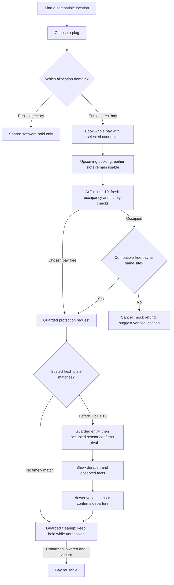

# Challenge questions turned into implementation work

The [Ecurious brief](../source/challenge-brief.pdf), pages 2–3, contains **20 guiding questions**. This plan covers all of them, with the most depth on no-shows, blocked bays and license-plate recognition. The questions are product prompts, not instructions to enable equipment or collect more personal data. Page 4 gives technical implementation 30% of the score and makes the real hardware cycle a prerequisite for top ranks: finish one supervised full cycle before adding broader features.

**Status vocabulary:** **implemented** means code exists, with the verification limits in [BUILD-LOG.md](BUILD-LOG.md); **proposed** means work still to build. The current shared reservations and mock prices are implemented. The existing worker reads Ecurious's built-in plate recognition; a separate YOLO/OCR model is optional. Live barrier movement, actual camera recognition accuracy and electrical charging have not been verified. The `/simulation` scenario lab exercises fictional cars without controlling Ecurious hardware; it cannot replace the physical demonstration. Privacy is a requirement across this plan: [PRIVACY.md](PRIVACY.md) lists the technical controls and the remaining Ecurious operator work, with official sources; this repository is not a compliance certification.

**Priority:** **P0** for the hackathon's main story; **P1** after that cycle works; **P2** for the scaling plan. Privacy and physical safety apply at every priority; P1/P2 are feature order, not exemptions for live processing. Lab checks are deterministic rehearsal checks, not proof of database concurrency, model accuracy or physical movement.

## One driver workflow

For arrival at **15:00**, scheduled protection is attempted from **14:50**, and the unused deadline is **15:10**. Each accepted **€1 mock** addition extends that deadline ten minutes. A timely trusted plate match stops unused-hold expiry; a separate sensor sequence establishes parking and departure. Future bookings constrain overlapping intervals but do not mark a currently idle bay held before the lead-in. Charging time is not booked or measured by this arrival window.

Keep the three domains visible in every demonstration: GoingElectric listed plugs have virtual app holds; registered inventory allocates a whole physical vehicle bay; the independent `/reserve` simulator has separate memory/state. See [system design](SYSTEM-DESIGN.md), [scheduled sessions](SCHEDULED-SESSIONS.md) and [bay lifecycle](BAY-LIFECYCLE.md).

## No-shows — questions 1–3, pages 2–3

| Question | Current behavior and concrete implementation suggestion | Priority and demonstration |
| --- | --- | --- |
| **1. How long should a reservation be held; grace, automatic release, reminders?** | **Implemented:** Now is ten minutes free. Scheduled is T−10 to T+10, plus accepted ten-minute additions. The database clock and `protection_deadline_at` decide expiry; cleanup must be confirmed before a physical bay reopens. **Proposed:** add two reminders—when protection begins and five minutes before the unused deadline—with one-tap **Add 10 minutes** and **Cancel**. Initially use foreground banners in Bookings; later create server notification jobs keyed by booking/deadline version, invalidated on extension, match or cancellation. A local phone countdown must never free the bay. | **P0:** show no-show at the deadline, extension before the deadline, and the bay remaining unavailable during unresolved cleanup. **P1:** reminders. |
| **2. How do we detect the driver is not coming: GPS, ETA or check-in?** | **Implemented:** absence of a timely accepted match produces an **unused hold**, not proof the driver abandoned the trip or that the bay is empty. **Proposed:** optional foreground ETA can recommend cancellation or an extension. Send only an ETA estimate, not a location trail. Treat **I'm on my way** as advisory; do not extend or authorize entry without an explicit accepted request. Classify missing/offline recognition or occupancy as **unresolved service evidence**, rather than a billable no-show. | **P0:** mismatch, stale event and no event must not invent arrival or vacancy. **P1:** ETA advice, with notification/location permission optional. |
| **3. How can a no-show be priced fairly?** | **Implemented:** free Now, €1 mock scheduled booking, €1 mock per accepted ten-minute extension; no automatic extra no-show charge. **Proposed:** first validate that service was actually protected and available. Store an outcome reason separate from payment status, with operator-failure waiver and a dispute path. Quote the total and cutoff before confirmation; a timeout/duplicate request must not add a second fee. If piloting a no-show fee later, make it a separate disclosed experiment with human review for ambiguous arrival evidence. Do not turn the older commercial scenarios into app prices implicitly. | **P0:** show a fictional receipt and duplicate-extension idempotency. **P1:** waiver/review UI. [Business model](BUSINESS-MODEL.md) contains assumptions, not implemented charges. |

Implementation anchors: `request_hardware_slot_extension`, `reconcile_hardware_slots`, `reconcile_hardware_deadlines` and `authorize_hardware_plate_entry` in [database contracts](DATABASE.md#scheduled-physical-sessions); `lib/hardware-slots.mjs`; the Bookings and session screens. Deadline reconciliation and extension must reread the cutoff under the same control lock so a worker cannot expire an extension accepted concurrently.

## Blocked bays — questions 4–6, page 3

| Question | Current behavior and concrete implementation suggestion | Priority and demonstration |
| --- | --- | --- |
| **4. What if an ICE car, non-charging EV or charging EV is already there?** | **Implemented:** fresh occupied telemetry blocks activation regardless of vehicle class. Before activation, try another compatible **physical bay** at the same registered site; another connector on the occupied bay is insufficient. If all eligible bays are unavailable, cancel, record a mock refund and suggest confirmed alternatives. **Proposed:** operator-supplied reason categories can improve support. Do not infer ICE/EV or charging from a plate alone, interrupt electricity, or move a barrier under an occupied/unknown space. | **P0:** unrelated car takes the requested bay; second run fills the whole location. Show fallback versus refund explicitly. |
| **5. How is blocking detected and the waiting driver informed or rerouted?** | **Implemented:** occupancy is the primary fact; recognition identifies a candidate vehicle, not vacancy. The driver sees blocked/unknown state and compatible alternatives. **Proposed:** add a clear Bookings banner—**Your bay changed**, **Site full—mock fee returned**, or **Status uncertain—contact operator**—with the original and assigned bay labels. Have the backend emit a versioned booking-state event/outbox for push delivery; the foreground five-second read remains recovery. Opening directions should require the driver to select a suggested location; rebooking must recheck atomically. | **P0:** show reassignment, no available alternatives, and a stale sensor. **P1:** push delivery and navigation deep links. |
| **6. Who is responsible and how does the operator respond?** | **Implemented:** uncertain commands remain quarantined; there is no driver override. **Proposed:** a small operator incident queue with booking reference, bay, fixed reason, observation age, last acknowledged operation and **acknowledged/resolved** timestamps. The site/CPO handles the physical obstruction and parking authority; BayReady handles notices, allocation and mock refund. Escalate from automatic fallback → site contact → supervised recovery. For no-ACK commands, the operator must first stop dispatchers and account for delayed senders; a matching GET alone cannot clear the guard. | **P0:** show the operator recovery checklist and retained hold. **P1:** incident queue; propose response targets only after the operator agrees them. |

Use [HARDWARE-SETUP.md](HARDWARE-SETUP.md) for enrollment/recovery and [ECURIOUS-API.md](ECURIOUS-API.md) for observed fields. The actual occupancy field is `carPresence: "vacant" | "occupied"`; missing, stale, contradictory or unfamiliar values stay unknown.

## License plates — questions 7–10, page 3

| Question | Current behavior and concrete implementation suggestion | Priority and demonstration |
| --- | --- | --- |
| **7. How is the plate linked, including a different car?** | **Implemented:** the hardware booking sends the selected plate transiently to Node; only a keyed HMAC and masked suffix reach SQL. Matching uses the trusted backend path. Editing the local profile does **not** rewrite an existing booking's plate. **Current practical flow:** before protection, cancel and rebook with the replacement vehicle; cancellation plus new booking is not atomic and can lose the slot. **Proposed:** an owner-only **Change vehicle** intent, before protection only, that normalizes/HMACs on Node, locks bay/control/slot, verifies the booking is unactivated, rejects an active dispatch/authorization, then replaces the fingerprint/mask and records a redacted version. Refuse changes after protection starts until a supervised safe transition is designed. | **P0:** reserve with Car A, arrive with Car B and prove entry stays unauthorized; cancel/rebook with B before protection and try again. **P1:** atomic change-vehicle feature. |
| **8. How can a camera trigger entry or a charging session?** | **Implemented:** the worker calls Ecurious `GET /api/v1/locks/:id/plate/latest` through the private `getPlateMatch()` adapter and compares the returned plate against the active booking HMAC. A fresh match under database guards queues entry; guarded dispatch and newer sensor observations establish opening separately. The optional `/api/integrations/plate-recognition` route supports an external service, but is not required. Sensor-confirmed arrival starts displayed parking duration. **Proposed:** consume authenticated charger transaction events and correlate stable bay/connector/transaction IDs before marking electrical charging active. A plate match alone cannot start or prove real charging; a charger command needs its own contract. | **P0:** built-in Ecurious recognition → queued entry → newer lowered/occupied observation → session duration. Show live kW/kWh unavailable until actual telemetry exists. |
| **9. How are dirt, darkness, foreign or temporary plates handled?** | **Implemented:** mismatches and expired, future-dated, stale or pre-protection observations cannot authorize entry. Ecurious's latest-plate response has `plateType`, **no confidence score**; it cannot enforce a numeric OCR-quality cutoff. The 0.90 threshold belongs only to the fictional lab and optional external-service handoff, where it is an uncalibrated assumption. **Proposed:** test built-in recognition on approved cases and measure errors by condition; ask the provider for reliability/quality signals. Preserve **uncertain** instead of choosing the nearest booked plate. Add authenticated operator-assisted verification, not a phone-declared match. Define plate-country/normalization rules before adding fuzzy matching. | **P0:** wrong vehicle, corrected built-in scan and stale/late recognition. Low confidence is a labelled lab/external-service case. **P1:** measured quality and supervised fallback. |
| **10. How do we minimise data and handle retention/consent?** | **Implemented:** profile stays in SecureStore; contact fields and plate are optional for public software holds. Only hardware bookings require a plate. Privacy controls export/delete that local profile, export current-account BayReady booking data and record an owner-only erasure request marked **pending Ecurious review**. A request is not fulfilled deletion. Contacts/mock payment are not uploaded with a hardware booking. Node keeps raw scan text in request memory; private SQL stores HMAC/mask/event digest, no application camera-image archive. **Proposed:** Ecurious must confirm its legal identity/contact, roles, lawful basis, camera notices, supplier retention and full rights handling. Implement purpose-specific retention/purge with separately justified restricted recovery evidence. Consent is not automatically the right legal basis; hashing is not anonymisation or proof of GDPR compliance. | **P0:** demonstrate the privacy controls with fictional data and their exact scope. Required operating measures apply before real-driver collection, not after a future feature sprint. See [PRIVACY.md](PRIVACY.md). |

### Primary integration: Ecurious's built-in recognition

No custom model is needed for the primary hardware test. The running worker already polls `GET /api/v1/locks/:id/plate/latest`, compares raw text privately in Node against the booking HMAC, and submits the match timestamp/digest to the guarded database authorization. Only an active protected booking, a timely matching observation and fresh safe device facts can queue entry. The provider's response supplies `plateType`, not a confidence score. Use the actual camera with a permitted fictional test plate, or an organiser-approved device test event; do not describe a whitelist write as injecting OCR.

`POST /api/v1/locks/:id/whitelist` changes persistent device automatic-access policy and may cause automatic lowering; it is neither a booking with an expiry nor a plate-event simulator. The current backend-controlled entry path requires automatic access disabled so the device and worker cannot independently lower the same barrier. A temporary specific-plate policy would be an alternative future controller: it needs a durable claim, supervised policy installation/revocation and uncertain-cleanup handling. The HMAC stored at booking cannot be reversed to reconstruct the plaintext plate at T−10. See [MODEL-INTEGRATION.md](MODEL-INTEGRATION.md) and [ECURIOUS-API.md](ECURIOUS-API.md).

### Optional external model

If the team later uses a separate YOLO/OCR service, keep it outside Expo and send only **plate text, confidence, UTC capture time, event UUID and enrolled camera/lock mapping** with the private service credential. A detector alone may not read characters. First verify its output, confidence meaning, runtime and privacy settings. The optional [private handoff](API.md#private-recognition-service-handoff) rejects stale events and uses a prototype 0.90 cutoff; this policy does not apply to native Ecurious reads. Reuse event UUIDs for retries and retain no raw captures by default. Phones never provide authoritative matches.

## Interoperability — questions 11–13, page 3

| Question | Concrete implementation suggestion and existing starting point | Priority and demonstration |
| --- | --- | --- |
| **11. How can other apps/providers reserve: open API, OCPI or OCPP?** | **Proposed:** publish a narrow versioned partner API around the existing allocation engine: inventory lookup, quote, create, read, cancel and signed status callbacks. Issue partner credentials with tenant/resource scopes; retain owner authorization, idempotency and whole-bay exclusion on the server. Map partner reservation IDs to one internal booking UUID. Write a provider adapter and contract tests for each protocol/version only after confirming its real commands and callbacks. Existing internal HTTP routes are a starting point, not a public roaming or OCPI/OCPP implementation. | **P2:** show an interface sketch and two clients competing for one backend allocation; label protocol mapping unimplemented. |
| **12. How should deep links, roaming or a shared standard link the flow?** | **Proposed:** a verified app/universal link such as `/booking/<opaque-reference>` opens the authenticated booking screen; require ownership before exposing details. A station link can carry a public resource reference and reopen a quote, never auto-charge/reserve or include a plate/token. Expose canonical UTC times plus policy/version and stable operator-assigned location/bay/connector IDs. GoingElectric IDs/hashes are not a physical mapping or permission to redistribute the directory. | **P1:** app links for a returning driver. **P2:** roaming resource/settlement agreements. |
| **13. How is app A's booking recognised for a driver using app B?** | **Proposed:** the on-site check must resolve the same backend booking and enrolled bay, regardless of the creating UI. A partner keeps its user identity mapped to a scoped internal owner; exchanging a short-lived authorization can let app B display the booking only after authentication/consent. Plate correlation remains private to the service; do not send a list of booked plates to partners or trust a screenshot/claim from app B. Define cancellation/refund authority and webhook replay handling. | **P2:** two fictional clients share allocation and the trusted scan still identifies the right booking. This is an architecture demonstration, not roaming support. |

## New uses — questions 14–15, page 3

| Question | Concrete implementation suggestion | Priority and demonstration |
| --- | --- | --- |
| **14. Events, hotels, workplaces or fleets?** | **Proposed:** reuse the registered whole-bay engine with `operator_id`, policy templates, opening hours and role-scoped inventory. Event tickets can grant a limited booking entitlement; hotel stays can make a bay available only within check-in/out; fleets can assign a vehicle per trip. Keep entitlement separate from the physical booking, and set quotas so a fleet cannot reserve all public capacity. Begin with one site type and its actual operator agreement. | **P2:** present an event arrival-window example using fictional registered inventory, without copying the public directory. |
| **15. Retail loyalty benefit?** | **Proposed:** a retailer issues a single-use signed sponsorship entitlement to the backend. A quote shows **€1 sponsored; driver €0**; redemption and reservation commit atomically, and cancellation/refund rules restore or consume the entitlement explicitly. Keep retailer identity/reward records separate from private plate matching. Track actual incremental store margin and support cost before calling it profitable. | **P2:** mock sponsored receipt and rejection of a reused entitlement; no new payment integration needed for the concept. |

## Utilisation — questions 16–17, page 3

| Question | Concrete implementation suggestion | Priority and demonstration |
| --- | --- | --- |
| **16. How do reservations increase utilisation instead of leaving empty bays?** | **Implemented:** future bookings defer protection until T−10; immediate holds are short, unused holds expire, and a match switches to sensor-driven completion. **Proposed:** limit the site's fraction of reservable bays, allow only one overlapping driver hold, release cancelled lead-ins promptly, and adjust lead-in length only from pilot evidence. Measure whether held-empty time displaced walk-ins; a fee is not evidence of better charging utilisation. Do not accept a new arrival promise merely because the preceding driver's calendar window ended while the vehicle remains parked. | **P0:** advance to T−11 and show the bay still usable, then T−10 protection. **P1:** site quota/anti-hoarding policy and measured lead-in experiment. |
| **17. Which CPO data/KPIs demonstrate an effect?** | **Proposed:** derive redacted booking outcomes from the durable ledger: accepted, protected, plate-authorized, occupied, departed, cleanup complete, fallback/refund and operator incident timestamps. Count empty held minutes, arrival success, verified no-shows, promise failures, recovery time and displaced demand separately. Electrical utilisation needs authenticated charging minutes/kWh plus serviceable capacity; occupancy and nameplate power are not energy evidence. Compare site-level outcomes against a matched baseline and account for movement between bays. | **P0:** small lab summary labelled **simulated outcomes**. **P1:** event export/dashboard; [business model](BUSINESS-MODEL.md#10-validation-plan-and-go-no-go-rules) defines pilot KPIs. |

## Business — questions 18–20, page 3

| Question | Concrete implementation suggestion | Priority and demonstration |
| --- | --- | --- |
| **18. Who pays: driver, CPO, retailer or app provider?** | **Proposed:** assign one merchant/fee owner per quote and one service-responsible operator per bay. Keep driver reservation payments, retailer sponsorship, CPO subscription and partner settlement as separate ledger concepts. Start with CPO/host-funded operation and fictional driver prices; ask the buyer which measurable problem justifies paying. A mock payment selection is not a card mandate. | **P0:** explain one payer and recovery owner for the chosen pilot. **P2:** settlement/contracts. |
| **19. Reservation fee, no-show fee, subscription or revenue share?** | **Implemented prototype:** Now €0, Scheduled €1 mock, each accepted +10 minutes €1 mock; failures can record mock refunds. **Proposed:** keep this easy-to-explain demo tariff. Test a subscription or sponsored reservation with an operator later; if adding real money, make server quotes versioned, use processor idempotency, verify signed payment events and reconcile refunds. Do not collect a no-show penalty based solely on missing recognition or build profitability around penalties. [BUSINESS-MODEL.md](BUSINESS-MODEL.md) compares commercial experiments separately. | **P0:** free/paid mock choices, one accepted extension, full-site mock refund. **P2:** real processor/settlement. |
| **20. What is a guaranteed spot worth to driver and operator?** | **Proposed:** define the promise narrowly—confirmed access to an operational mapped bay during an arrival window, with an explicit failure remedy—before marketing a guarantee. Interview drivers about avoided detours/waiting and test willingness to pay only after reliable service. For the CPO, calculate extra site charging contribution **minus** empty-hold displacement, equipment, support, payment and refund costs. Use measured energy and demand, not plug count × rated kW. Present negative cases as well as positive ones; no uplift or reliability guarantee has yet been established. | **P0:** clear value statement plus one failure recovery. **P1:** pilot baseline and willingness-to-pay test; do not quote illustrative ROI as observed revenue. |

## Build order and jury story

The fictional lab contains three car instances, two physical bays at the main location and one at a nearby location. Select **Scenario lab** in the app, or open `/simulation`, then run:

| Scenario ID | What it rehearses | Guiding questions |
| --- | --- | --- |
| `race` | Two car instances request the same bay; a whole-bay allocation cannot be split across connectors. The lab serializes fictional actions; real database concurrency is a separate check. | 7, 11, 13 |
| `plate-check` | Wrong car and low confidence do not authorize entry; a matching event requests opening, and a separate observation confirms it. | 7–9 |
| `no-show` | Unused hold expires; command intent and observed cleanup remain separate before reopening. | 1–3 |
| `extension` | Adding minutes moves the unused deadline with an explicit mock fee. | 1, 3, 19 |
| `scheduled-window` | Before T−10, no early physical hold; protection begins at T−10 and unused grace ends at T+10. | 1, 16 |
| `blocked-fallback` | Unrelated occupancy triggers a different compatible vehicle bay at the same site. | 4–6 |
| `full-refund` | Full location produces a mock refund and nearby-location suggestion. | 4–6, 18–20 |

Each scenario resets its fictional world. Manual scans choose a fixed fictional car and confidence, rather than uploading a plate or camera frame. This UI is an untrusted simulation control; native Ecurious OCR is read privately by the worker, and an optional external model uses the separate handoff above. The original `/reserve` simulator and hosted bookings remain separate.

1. **Rehearse different cars without hardware.** One fictional booked car, one unrelated blocker and one replacement car; show correct match, refusal, low confidence, no-show, extension, concurrent booking conflict and cleanup. Distinguish each simulated observation from an actual device fact.
2. **Use the existing Ecurious plate adapter.** Confirm the assigned camera/lock mapping, response shape and capture timestamps. Test built-in recognition with a permitted fictional plate; compare expected match/no-match results through the current HMAC path. Keep command activation off until the mentor confirms mapping/interlocks and supervises the test. A separate model is optional follow-on work.
3. **Prove one live cycle.** Confirm assigned test bay, fresh occupancy, disabled automatic wildcard access and safety interlocks; then reserve → acknowledged and observed protection → trusted matching arrival → observed entry → organiser-agreed charging evidence → observed departure → completed cleanup. Record actual evidence and failures in BUILD-LOG.
4. **Demonstrate the two recovery stories.** No-show with safe expiry; blocked target with a different physical bay, then all bays full with mock refund. Explain stale sensors, unknown command delivery and the operator path.
5. **Pitch the measured next step.** Show the architecture, state what is still simulated, and propose a limited operator pilot measuring net charging contribution and driver promise failures. Broader partner APIs, loyalty and payments are follow-on work.

Suggested three-minute narration: **“Finding a plug does not establish that its vehicle bay is usable. We allocate the whole bay, protect only near arrival, and admit a car through a trusted recognition plus guarded movement. When we cannot supply the bay, we reassign or refund instead of hiding the failure. Our next test is whether this recovers more usable charging time than reservations withhold.”** Show actual hardware evidence separately from accelerated scenario results. See [PITCH.md](PITCH.md).
