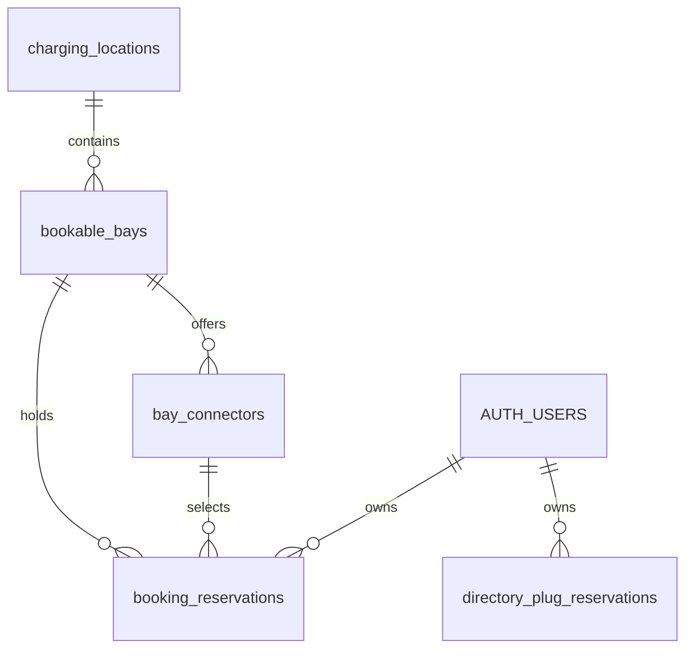

# Database design

BayReady has two separate shared booking models: app-only holds on virtual choices from the GoingElectric listing, and holds on administrator-registered physical bays. Both use Supabase PostgreSQL and guest Auth identities. Neither currently sends hardware commands or proves that a parking space is physically free.

The migrations and mobile clients are prepared and have passed isolated PostgreSQL tests. Hosted schema installation, anonymous Auth activation, real Auth/PostgREST calls, and synchronization between phones remain unverified. Follow [Supabase setup](SUPABASE.md) for activation; this document describes the data contract and its limits.

## Sources of authority

| Information | Authority | What the database knows |
| --- | --- | --- |
| Public station names, coordinates, connector types, power and listed counts | GoingElectric, requested directly by the phone | No copied directory catalog |
| BayReady hold on a listed choice | `directory_plug_reservations` | Station reference, opaque virtual slot key, owner and deadline |
| Registered locations, physical bays and identified plugs | Administrator-provided inventory | Explicit rows in `charging_locations`, `bookable_bays` and `bay_connectors` |
| BayReady hold on a registered bay | `booking_reservations` | The selected connector and an exclusive hold on its whole bay |
| Physical occupancy, barrier position and hardware faults | Ecurious telemetry, read separately by the Node backend | No authoritative sensor state stored in this schema |
| Driver profile and mock payment preference | Device SecureStore | No profile, raw plate, contact or payment fields uploaded to these tables |

The in-memory `/reserve` simulator is a third, independent rehearsal flow. Its state is not stored in Supabase. See [integration boundaries](INTEGRATION.md) and [the Ecurious contract](ECURIOUS-API.md).

## Relationships and allocation units



`AUTH_USERS` represents Supabase's existing `auth.users` table. The application migrations reference it; they do not create a replacement Auth service. Directory holds have no foreign key to registered inventory or a copied station table.

| Model | Unit held exclusively | Meaning of an unreserved result |
| --- | --- | --- |
| Directory-listed choice | `(station_id, slot_key)` | No active BayReady hold on that virtual choice |
| Registered inventory | `bay_id`, across all its connectors | No active BayReady hold on that registered physical bay |

Directory choices are independent app allocations because the source does not identify their physical bay assignments or simultaneous charging capacity. Registered bay A1 can offer two plugs to one vehicle; choosing either plug holds A1 and prevents another booking through its other plug.

These domains do not synchronize automatically. A directory hold does not hold a registered bay, and a registered-bay hold does not create a directory hold. An optional GoingElectric mapping is not a hardware authorization or a cross-domain locking rule. A future physical integration must resolve that mapping and choose one authoritative allocation path before claiming a guaranteed bay.

## Stored tables

All five application tables have row-level security enabled. Direct table privileges are revoked from `PUBLIC`, `anon` and `authenticated`. Phones access projected RPC results, not raw rows.

### `public.charging_locations`

| Column | Type / default | Rule |
| --- | --- | --- |
| `id` | UUID, generated | Primary key |
| `label` | Text, required | Trimmed length 1–120 |
| `goingelectric_id` | Bigint, nullable | Positive when present; optional administrator-confirmed reference, not unique |
| `latitude`, `longitude` | Double precision, nullable | Both absent or both present; ranges −90…90 and −180…180 |
| `created_at` | Timestamptz, database clock | Required creation time |

Coordinates are fictional/demo or supplied by an operator. No automated directory import populates this table. Missing coordinates remain representable rather than inventing a location; the mobile map can omit an unrenderable location while retaining booking context.

### `public.bookable_bays`

| Column | Type / default | Rule |
| --- | --- | --- |
| `id` | UUID, generated | Primary key; identifies one physical one-vehicle space |
| `location_id` | UUID, required | References `charging_locations`; location deletion restricted |
| `label` | Text, required | Trimmed length 1–120 |
| `integration_mode` | Text, `demo` | Only `demo` or `ecurious` |
| `ecurious_lock_id` | Text, nullable, unique | Must be absent for demo rows; nonblank and present for Ecurious rows |
| `enabled` | Boolean, `false` | Controls visibility in the registered-inventory list RPC |
| `created_at` | Timestamptz, database clock | Required creation time |

An enabled bay is not necessarily bookable: new `reserve_bay` calls also require demo mode and a selected enabled connector. Real Ecurious mode is deliberately refused. An enabled bay with no enabled plugs can still be returned as inventory, without a selectable booking option.

### `public.bay_connectors`

| Column | Type / default | Rule |
| --- | --- | --- |
| `id` | UUID, generated | Primary key; identifies one operator-registered plug |
| `bay_id` | UUID, required | References `bookable_bays`; connector rows cascade if their bay can be deleted |
| `label` | Text, required | Trimmed length 1–120 |
| `connector_type` | Text, required | Trimmed length 1–40; not a database enum |
| `power_kw` | Numeric, required | 0–2000 inclusive; an enabled connector must have power greater than zero |
| `enabled` | Boolean, `false` | Required for a new hold |
| `created_at` | Timestamptz, database clock | Required creation time |

The power bound matches the current phone contract and rejects negative, nonfinite and excessive values. `CCS` and `Typ2` are seeded values; `UNKNOWN` with zero power and `enabled=false` preserves old bookings whose selected plug was never recorded. Connector compatibility is a client preference filter, not an additional server-side vehicle eligibility check.

`UNIQUE (id, bay_id)` supports a composite reservation foreign key. This prevents even a direct administrator insert from pairing a connector with another physical bay.

### `public.booking_reservations`

| Column | Type / default | Rule |
| --- | --- | --- |
| `id` | UUID, generated | Primary key |
| `bay_id` | UUID, required | References the registered bay; deletion restricted |
| `connector_id` | UUID, required | `(connector_id, bay_id)` references the same connector/bay pair; deletion restricted |
| `owner_id` | UUID, required | References `auth.users`; user deletion cascades to their reservations |
| `starts_at`, `expires_at` | Timestamptz, required | Positive interval, no longer than 30 minutes |
| `status` | Text, `held` | Only `held`, `cancelled` or `expired` |
| `idempotency_key` | UUID, required | Unique together with `owner_id` |
| `created_at` | Timestamptz, database clock | RPC sets it equal to `starts_at` |

`booking_reservations_one_held_per_bay` is a unique index on `bay_id WHERE status='held'`. A second connector does not create a second allocatable parking space. An owner/creation-time index supports ownership history, with additional foreign-key lookup indexes on bay locations and connectors.

### `public.directory_plug_reservations`

| Column | Type / default | Rule |
| --- | --- | --- |
| `id` | UUID, generated | Primary key |
| `station_id` | Bigint, required | 1…9007199254740991, preserving exact JavaScript/JSON identity |
| `slot_key` | Text, required | Exactly 64 lowercase hexadecimal characters |
| `owner_id` | UUID, required | References `auth.users`; user deletion cascades to their holds |
| `created_at`, `expires_at` | Timestamptz, required | Positive interval, no longer than 30 minutes |
| `status` | Text, `held` | Only `held`, `cancelled` or `expired` |
| `idempotency_key` | UUID, required | Unique together with `owner_id` within this table |

`directory_plug_one_held_slot` is a unique index on `(station_id, slot_key) WHERE status='held'`. An owner/creation-time index supports ownership reads. There are no station names, locations, connector descriptions, source counts, raw plates or camera data in these rows.

There is no need to provision every empty slot. After a successful, current hold read for a station, a listed choice absent from the returned holds is app-unreserved. Missing schema, a failed request, an unqueried station or stale data does not establish an unreserved result.

## Virtual directory keys

The phone derives shared allocation keys in [directory-slots.ts](../mobile/src/lib/directory-slots.ts). It merges identical connector type/power groups and generates:

```text
canonical = JSON.stringify(["bayready-directory-v1", stationId, type, power])
slotKey   = SHA256(canonical).slice(0, 56)
            + ordinal.toString(16).padStart(8, "0")
```

The ordinal starts at 1. Reordering source groups does not change keys, and increasing a group's count retains existing ordinal keys. A type/power change or a count reduction can leave an active hold without a corresponding current listed choice. Owned holds remain retrievable and cancellable even after a viewport or catalog change.

This is a virtual identity, not an operator's physical connector ID. The database checks its format, not the hash algorithm, actual ordinal, source count or station existence. Catalog data stays on the phone; the service does not fetch a directory catalog to validate incoming claims. That trust limit is acceptable for this software prototype, not evidence of physical capacity enforcement.

## Auth and RPC access

The public Supabase client key identifies the project. A separate anonymous Auth sign-in creates a guest `auth.users` identity and an `authenticated` session. Merely possessing an anon/publishable key does not grant booking RPC execution.

All six application RPCs use `SECURITY DEFINER`, an empty `search_path`, qualified relation references, and an explicit non-null `auth.uid()` check. Function execution is revoked from `PUBLIC` and `anon`, then granted to `authenticated`. There are no direct client table policies; function-owner execution deliberately performs the checks and returns curated fields. This boundary does not restrict project administrators or substitute for keeping privileged credentials off the phone.

### Registered inventory RPCs

```sql
list_bay_availability() returns jsonb
reserve_bay(
  p_bay_id uuid,
  p_hold_minutes integer default 10,
  p_request_id uuid default null,
  p_connector_id uuid default null
) returns jsonb
cancel_reservation(p_reservation_id uuid) returns jsonb
```

`reserve_bay` still requires a request UUID and connector UUID at runtime. SQL accepts 1–30 minutes; the UI offers 5, 10 or 15. The earlier three-argument overload is removed to avoid ambiguous PostgREST function resolution.

`list_bay_availability` returns:

```text
{ serverNow, bays: [{
  id, label, locationId, locationLabel, goingelectricId,
  latitude, longitude, mode, lockId,
  connectors: [{ id, label, type, powerKw, enabled }],
  availability: "unreserved" | "reserved",
  reservedUntil, isMine, myReservationId, myConnectorId
}] }
```

Only enabled bays are listed; disabled connectors remain included with their explicit state. Other holders' identities and reservation IDs are omitted. `myReservationId` and `myConnectorId` are present only for the caller's own active hold, otherwise null. An unreserved result has a null deadline and no ownership fields. Location coordinates and directory mapping can be null.

Reserve/cancel results are `{id, bayId, connectorId, status, startsAt, createdAt, expiresAt}`. Dates are serialized database timestamps. A list response is a booking observation, not a promise that a later write cannot conflict.

### Directory hold RPCs

```sql
list_directory_holds(p_station_ids bigint[]) returns jsonb
reserve_directory_plug(
  p_station_id bigint,
  p_slot_key text,
  p_hold_minutes integer,
  p_request_id uuid
) returns jsonb
cancel_directory_hold(p_reservation_id uuid) returns jsonb
```

The list input is a one-dimensional array of at most 500 positive safe-integer station IDs. An empty array is valid. The result is:

```text
{ serverNow, holds: [{
  stationId, slotKey, reservedUntil, isMine, myReservationId
}] }
```

It includes active holds for requested stations **plus all caller-owned active holds**, even outside the requested area. An empty input restores owned holds without exposing other stations' holders. Other users receive only slot/deadline information and `myReservationId:null`; owner IDs are never returned. This also preserves cancellation access to orphan keys.

Reserve/cancel results are `{id, stationId, slotKey, status, createdAt, expiresAt}`. No GoingElectric catalog fields or vehicle profile fields are accepted by these RPCs.

### Fixed application errors

| Error message | Meaning |
| --- | --- |
| `AUTH_REQUIRED` | No authenticated guest/user identity |
| `INVALID_HOLD` | Duration absent or outside SQL's 1–30 minute range |
| `REQUEST_ID_REQUIRED` | Missing request UUID |
| `IDEMPOTENCY_CONFLICT` | A prior request UUID was reused with different allocation parameters |
| `RESERVATION_NOT_FOUND` | Unknown reservation or one belonging to somebody else |
| `BAY_NOT_FOUND`, `BAY_DISABLED`, `BAY_NOT_BOOKABLE` | Missing, disabled or non-demo registered bay |
| `CONNECTOR_REQUIRED`, `CONNECTOR_NOT_AVAILABLE` | Missing connector or one disabled/not belonging to the target bay |
| `BAY_RESERVED` | Registered physical bay already held |
| `INVALID_STATION`, `INVALID_STATIONS`, `INVALID_SLOT` | Invalid directory reference or list scope |
| `PLUG_RESERVED` | Virtual station/slot pair already held |

Auth failures use SQLSTATE `42501`, invalid scalar/list input uses `22023`, and semantic conflicts/refusals use `P0001`. Invalid SQL argument types can be rejected before a function runs. The phone maps known errors to fixed messages and does not display arbitrary upstream error text.

## Atomic allocation and retries

Both reserve paths first take a transaction-scoped advisory lock for the owner and inspect their request history. This serializes concurrent retries, including ones targeting different allocations. It does **not** limit an owner to one active hold. Idempotency uniqueness is per owner and per reservation table, not a shared cross-domain request ledger.

For a new registered-bay hold:

1. Compare any earlier matching request's bay, connector and duration; reject mismatches.
2. Lock the bay row with `FOR UPDATE`, then sample the database clock.
3. Reconcile elapsed `held` rows for that bay to `expired`.
4. Verify enabled demo inventory and lock/check the selected enabled connector with `FOR SHARE`.
5. Reject any remaining held row, then insert the new hold and deadline.

For a directory hold, the sequence is the same except that a transaction-scoped advisory lock on the station/slot pair replaces the inventory row lock. No physical inventory row or catalog verification is performed. Different directory slots can commit concurrently; competing requests for the same slot cannot both allocate it.

Each path retains a partial unique index as an independent database guard. All work commits together; an exception rolls back that transaction's changes. No application-controlled sequence of read-then-write calls is relied on for exclusivity.

A repeated request UUID with identical parameters returns the original reservation and deadline, including its later `cancelled` or `expired` status. It never renews or creates a replacement hold. In the registered domain, an existing request can still be returned after its inventory or connector was disabled. A deliberate new hold uses a new UUID.

The mobile client currently generates one UUID per deliberate reserve call, disables SDK write retries, and performs a read after success, rejection or uncertain delivery. It does not persist a request UUID for arbitrary later retransmission. The SQL contract supports exact retries, but the UI's recovery path is reconciliation rather than blind resend. See [bookings-api.ts](../mobile/src/lib/bookings-api.ts).

Cancellation takes the same owner lock and allocation lock order. It looks up only caller-owned history, so unknown IDs and somebody else's IDs produce the same error. Repeated cancellation returns the existing result. A past-deadline held row becomes `expired`; an unexpired held row becomes `cancelled`.

## Time, expiry and recovery

The database clock sets all new deadlines after allocation locks are acquired. A waiting request cannot reuse an old pre-lock time. Both list RPCs exclude holds whose deadline has passed, even if their stored status still says `held`.

Expiry is lazy: list calls have no cleanup writes, while reserve/cancel reconcile relevant rows within their transactions. The unique held indexes intentionally include elapsed rows until that reconciliation. A valid new reserve expires the stale row before inserting its replacement. There is no scheduled cleanup worker or cron requirement for app booking availability.

The phone polls while foregrounded and uses a local freshness guard. A displayed countdown reaching zero does not fabricate a new available state: the next successful database read confirms the booking outcome. Network failure or a changed directory scope invalidates the current availability observation. These are app connection rules, not hardware freshness thresholds.

Neither expiry nor cancellation sends a barrier command, changes a whitelist, proves physical vacancy, or records charging completion. There is no distributed transaction between PostgreSQL and Ecurious. A future live flow needs confirmed mapping, command reconciliation, occupancy interlocks and durable recovery; an outbox or equivalent command workflow has not been implemented.

## Migration history and seeds

| Migration | Effect |
| --- | --- |
| [Initial bookings](../supabase/migrations/20261024120000_bayready_reservations.sql) | Introduces registered bays, owned holds, RPC access, and one fictional demo bay |
| [Location/bay/connector hierarchy](../supabase/migrations/20261024130000_location_bay_connectors.sql) | Moves location fields into location rows, registers plugs, preserves previous holds, and replaces the reserve RPC signature |
| [Directory app holds](../supabase/migrations/20261024140000_directory_plug_holds.sql) | Adds virtual directory-slot holds and their separate RPCs without changing physical-bay allocation semantics |

The hierarchy migration preserves the original demo bay ID and creates its fictional location. Other existing bays each receive a separate location containing their previous label, coordinates and directory mapping; shared sites are not guessed. Bay-level coordinate/directory columns are then removed so location metadata has one authority.

For every bay with old reservations, it creates a disabled `UNKNOWN`/0 kW legacy connector and backfills those reservations to it. Original reservation IDs, owners, states, timestamps and request UUIDs survive. This records that the historical connector is unknown instead of inventing a selected plug. The owner can still cancel that hold.

The fresh seed is one fictional Berlin location (`52.52, 13.405`), three bays and four enabled plugs: A1 has CCS 150 kW and Type 2 22 kW; A2 has CCS 150 kW; A3 has Type 2 22 kW. There is no GoingElectric ID or Ecurious lock mapping. The directory domain has no inventory or initial reservation seed: unreserved app slots are derived from successful reads, not copied catalog rows.

Migrations are ordered schema changes, not idempotent setup scripts or a database reset. The test-only `_bayready_upgrade_expected` table is created by the upgrade fixture in a disposable database; it is not part of the deployed application schema.

## Validation and deployment limits

`npm run test:database` runs [the isolated Docker harness](../scripts/test-database.mjs). It applies the schema versions in order, tests the original contract, injects fictional upgrade history, then tests hierarchy preservation and directory holds. It creates minimal local Auth shims; no `.env`, remote Supabase account or directory API is used.

The SQL suites cover auth/grants/RLS, private projections, input constraints, ownership, expiry, cancellation, idempotency, connector/bay consistency, unknown historical plugs and migration preservation. Independent PostgreSQL sessions also verify:

- Different plugs on one registered bay produce one winner and `BAY_RESERVED`.
- Concurrent identical registered-bay requests return one ID and unchanged deadline.
- Two users requesting one virtual plug produce one winner and `PLUG_RESERVED`.
- Different virtual plugs can commit concurrently.
- Concurrent identical directory requests return one ID and unchanged deadline.
- Owner cancellation removes the active directory hold for other users.

These passed against PostgreSQL 17 in a container with no network, published port or persistent volume; the harness removes its own container. They do not establish hosted Auth configuration, JWT issuance, PostgREST exposure, two-phone behavior, production load characteristics or a real hardware cycle. See [build evidence](BUILD-LOG.md).

The current deployed-service gaps are explicit:

- The hosted schema and anonymous sign-in setup still require administrator activation and verification. There is no local fake success when that service is unavailable.
- Anonymous identity is device/session based. Losing that identity can lose owner cancellation access; account recovery and verified sign-in are not implemented.
- Cancelled and expired rows retain request history with no automated retention policy. Deleting an Auth user cascades their booking records; future cleanup must account for ownership recovery and any physical workflow.
- Inventory/connector deletion is restricted where booking history references it. Disablement preserves history, but disabled bays disappear from the registered list RPC; the database can cancel a known owned reservation ID while the current UI may need administrator help to rediscover a hidden bay's hold.
- There is no per-user active-hold quota, anonymous-account abuse control, catalog authenticity check or operator booking permission model for directory slots. Valid-looking caller-supplied station/slot references can create software holds without proving a real plug exists.
- Directory edits can orphan virtual choices. Owned holds are recoverable, but no physical connector reconciliation or external operator booking synchronization exists.
- No payments, no-show penalties, charging metering, physical reservation guarantee, OCPI/OCPP compliance or GDPR compliance is established by this schema.
