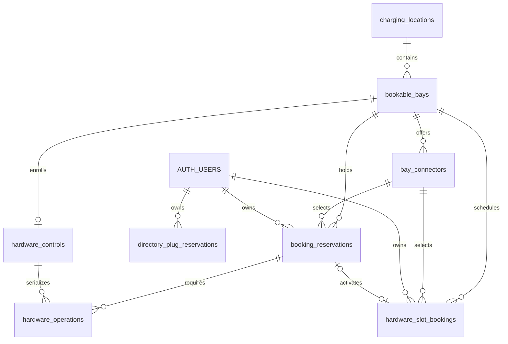

# Database design

BayReady has two shared booking models: app-only holds on virtual GoingElectric choices, and holds on administrator-registered bays. Both use Supabase PostgreSQL and guest Auth identities. Registered demo bays remain software-only. Explicitly enrolled Ecurious bays now have a separate durable workflow that can request real barrier movement through the gated backend; a booking intent alone never proves physical protection or vacancy.

The migrations and mobile clients are prepared and have passed isolated PostgreSQL tests. Hosted schema installation, anonymous Auth activation, real Auth/PostgREST calls, and synchronization between phones remain unverified. Follow [Supabase setup](SUPABASE.md) for activation; this document describes the data contract and its limits.

## Sources of authority

| Information | Authority | What the database knows |
| --- | --- | --- |
| Public station names, coordinates, connector types, power and listed counts | GoingElectric, requested directly by the phone | No copied directory catalog |
| BayReady hold on a listed choice | `directory_plug_reservations` | Station reference, opaque virtual slot key, owner and deadline |
| Registered locations, physical bays and identified plugs | Administrator-provided inventory | Explicit rows in `charging_locations`, `bookable_bays` and `bay_connectors` |
| BayReady hold on a registered bay | `booking_reservations` | The selected connector and an exclusive hold on its whole bay |
| Physical occupancy, barrier position and hardware faults | Ecurious telemetry, read by the Node backend | Selected provider observations are retained by the physical workflow with age/conflict guards; the provider remains the sensor source |
| Driver profile and mock payment preference | Device SecureStore | No raw plate, contact or payment fields in SQL; scheduled hardware bookings retain a backend HMAC and masked suffix |

The in-memory `/reserve` simulator is a third, independent rehearsal flow. Its state is not stored in Supabase. See [integration boundaries](INTEGRATION.md) and [the Ecurious contract](ECURIOUS-API.md).

## Relationships and allocation units



`AUTH_USERS` represents Supabase's existing `auth.users` table. The application migrations reference it; they do not create a replacement Auth service. Directory holds have no foreign key to registered inventory or a copied station table.

| Model | Unit held exclusively | Meaning of an unreserved result |
| --- | --- | --- |
| Directory-listed choice | `(station_id, slot_key)` | No active BayReady hold on that virtual choice |
| Registered inventory | `bay_id`, across all its connectors | No active BayReady hold on that registered physical bay |

Directory choices are independent app allocations because the source does not identify their physical bay assignments or simultaneous charging capacity. Registered bay A1 can offer two plugs to one vehicle; choosing either plug holds A1 and prevents another booking through its other plug.

These domains do not synchronize automatically. A directory hold does not hold a registered bay, and a registered-bay hold does not create a directory hold. An optional GoingElectric mapping is not a hardware authorization or a cross-domain locking rule. A future physical integration must resolve that mapping and choose one authoritative allocation path before claiming a guaranteed bay.

## Stored tables

All eight application tables have row-level security enabled. Direct table privileges are revoked from `PUBLIC`, `anon` and `authenticated`. Phones access projected RPC results, not raw rows. The private hardware tables and scheduling ledger are described below.

### `public.charging_locations`

| Column | Type / default | Rule |
| --- | --- | --- |
| `id` | UUID, generated | Primary key |
| `label` | Text, required | Trimmed length 1–120 |
| `goingelectric_id` | Bigint, nullable | Positive when present; optional administrator-confirmed reference, not unique |
| `latitude`, `longitude` | Double precision, nullable | Both absent or both present; ranges −90…90 and −180…180 |
| `created_at` | Timestamptz, database clock | Required creation time |

Coordinates are fictional/demo or supplied by an operator. No automated directory import populates this table. Missing coordinates remain representable rather than inventing a location; the mobile map can omit an unrenderable location while retaining booking context.

### `public.bookable_bays`

| Column | Type / default | Rule |
| --- | --- | --- |
| `id` | UUID, generated | Primary key; identifies one physical one-vehicle space |
| `location_id` | UUID, required | References `charging_locations`; location deletion restricted |
| `label` | Text, required | Trimmed length 1–120 |
| `integration_mode` | Text, `demo` | Only `demo` or `ecurious` |
| `ecurious_lock_id` | Text, nullable, unique | Must be absent for demo rows; nonblank and present for Ecurious rows |
| `enabled` | Boolean, `false` | Controls visibility in the registered-inventory list RPC |
| `created_at` | Timestamptz, database clock | Required creation time |

An enabled bay is not necessarily bookable: rehearsal `reserve_bay` calls require demo mode and an enabled connector. Ecurious mode uses the dedicated physical RPCs and control gates below. An enabled demo bay with no enabled plugs can still be returned as inventory, without a selectable booking option.

### `public.bay_connectors`

| Column | Type / default | Rule |
| --- | --- | --- |
| `id` | UUID, generated | Primary key; identifies one operator-registered plug |
| `bay_id` | UUID, required | References `bookable_bays`; connector rows cascade if their bay can be deleted |
| `label` | Text, required | Trimmed length 1–120 |
| `connector_type` | Text, required | Trimmed length 1–40; not a database enum |
| `power_kw` | Numeric, required | 0–2000 inclusive; an enabled connector must have power greater than zero |
| `enabled` | Boolean, `false` | Required for a new hold |
| `created_at` | Timestamptz, database clock | Required creation time |

The power bound matches the current phone contract and rejects negative, nonfinite and excessive values. `CCS` and `Typ2` are seeded values; `UNKNOWN` with zero power and `enabled=false` preserves old bookings whose selected plug was never recorded. Connector compatibility is a client preference filter, not an additional server-side vehicle eligibility check.

`UNIQUE (id, bay_id)` supports a composite reservation foreign key. This prevents even a direct administrator insert from pairing a connector with another physical bay.

### `public.booking_reservations`

| Column | Type / default | Rule |
| --- | --- | --- |
| `id` | UUID, generated | Primary key |
| `bay_id` | UUID, required | References the registered bay; deletion restricted |
| `connector_id` | UUID, required | `(connector_id, bay_id)` references the same connector/bay pair; deletion restricted |
| `owner_id` | UUID, required | References `auth.users`; user deletion cascades to their reservations |
| `starts_at`, `expires_at` | Timestamptz, required | Positive interval, no longer than 120 minutes; immediate/rehearsal RPCs still cap their own requests at 30 |
| `status` | Text, `held` | Only `held`, `cancelled` or `expired` |
| `idempotency_key` | UUID, required | Unique together with `owner_id` |
| `created_at` | Timestamptz, database clock | RPC sets it equal to `starts_at` |

`booking_reservations_one_held_per_bay` is a unique index on `bay_id WHERE status='held'`. A second connector does not create a second allocatable parking space. An owner/creation-time index supports ownership history, with additional foreign-key lookup indexes on bay locations and connectors.

### `public.directory_plug_reservations`

| Column | Type / default | Rule |
| --- | --- | --- |
| `id` | UUID, generated | Primary key |
| `station_id` | Bigint, required | 1…9007199254740991, preserving exact JavaScript/JSON identity |
| `slot_key` | Text, required | Exactly 64 lowercase hexadecimal characters |
| `owner_id` | UUID, required | References `auth.users`; user deletion cascades to their holds |
| `created_at`, `expires_at` | Timestamptz, required | Positive interval, no longer than 30 minutes |
| `status` | Text, `held` | Only `held`, `cancelled` or `expired` |
| `idempotency_key` | UUID, required | Unique together with `owner_id` within this table |

`directory_plug_one_held_slot` is a unique index on `(station_id, slot_key) WHERE status='held'`. An owner/creation-time index supports ownership reads. There are no station names, locations, connector descriptions, source counts, raw plates or camera data in these rows.

There is no need to provision every empty slot. After a successful, current hold read for a station, a listed choice absent from the returned holds is app-unreserved. Missing schema, a failed request, an unqueried station or stale data does not establish an unreserved result.

## Virtual directory keys

The phone derives shared allocation keys in [directory-slots.ts](../mobile/src/lib/directory-slots.ts). It merges identical connector type/power groups and generates:

```text
canonical = JSON.stringify(["bayready-directory-v1", stationId, type, power])
slotKey   = SHA256(canonical).slice(0, 56)
            + ordinal.toString(16).padStart(8, "0")
```

The ordinal starts at 1. Reordering source groups does not change keys, and increasing a group's count retains existing ordinal keys. A type/power change or a count reduction can leave an active hold without a corresponding current listed choice. Owned holds remain retrievable and cancellable even after a viewport or catalog change.

This is a virtual identity, not an operator's physical connector ID. The database checks its format, not the hash algorithm, actual ordinal, source count or station existence. Catalog data stays on the phone; the service does not fetch a directory catalog to validate incoming claims. That trust limit is acceptable for this software prototype, not evidence of physical capacity enforcement.

## Auth and RPC access

The public Supabase client key identifies the project. A separate anonymous Auth sign-in creates a guest `auth.users` identity and an `authenticated` session. Merely possessing an anon/publishable key does not grant booking RPC execution.

The Account screen can link and verify an email on the existing guest identity, then set a password; preserving its user UUID preserves reservation ownership. It also supports email/password sign-in. Email belongs to Supabase Auth, not the booking tables. Hosted anonymous Auth and manual-linking settings have been verified; email delivery, verification links/codes and cross-device account usage have not been exercised by the setup smoke checks.

The six software-booking RPCs use `SECURITY DEFINER`, an empty `search_path`, qualified relation references, and an explicit non-null `auth.uid()` check. Execution is revoked from `PUBLIC` and `anon`, then granted to `authenticated`. Physical workflow guest RPCs follow the same rule; worker RPCs are granted only to `service_role`. There are no direct client table policies; function-owner execution deliberately performs the checks and returns curated fields. This boundary does not restrict project administrators or substitute for keeping privileged credentials off the phone.

### Registered inventory RPCs

```sql
list_bay_availability() returns jsonb
reserve_bay(
  p_bay_id uuid,
  p_hold_minutes integer default 10,
  p_request_id uuid default null,
  p_connector_id uuid default null
) returns jsonb
cancel_reservation(p_reservation_id uuid) returns jsonb
```

`reserve_bay` still requires a request UUID and connector UUID at runtime. SQL accepts 1–30 minutes; the UI offers 5, 10 or 15. The earlier three-argument overload is removed to avoid ambiguous PostgREST function resolution.

`list_bay_availability` returns:

```text
{ serverNow, bays: [{
  id, label, locationId, locationLabel, goingelectricId,
  latitude, longitude, mode, lockId,
  connectors: [{ id, label, type, powerKw, enabled }],
  availability: "unreserved" | "reserved",
  reservedUntil, isMine, myReservationId, myConnectorId
}] }
```

Only enabled demo bays are listed; Ecurious bays now use `list_hardware_workflows` so an elapsed deadline cannot hide a still-protected physical booking. Disabled connectors remain included with their explicit state. Other holders' identities and reservation IDs are omitted. `myReservationId` and `myConnectorId` are present only for the caller's own active hold, otherwise null. An unreserved result has a null deadline and no ownership fields. Location coordinates and directory mapping can be null.

Reserve/cancel results are `{id, bayId, connectorId, status, startsAt, createdAt, expiresAt}`. Dates are serialized database timestamps. A list response is a booking observation, not a promise that a later write cannot conflict.

### Directory hold RPCs

```sql
list_directory_holds(p_station_ids bigint[]) returns jsonb
reserve_directory_plug(
  p_station_id bigint,
  p_slot_key text,
  p_hold_minutes integer,
  p_request_id uuid
) returns jsonb
cancel_directory_hold(p_reservation_id uuid) returns jsonb
```

The list input is a one-dimensional array of at most 500 positive safe-integer station IDs. An empty array is valid. The result is:

```text
{ serverNow, holds: [{
  stationId, slotKey, reservedUntil, isMine, myReservationId
}] }
```

It includes active holds for requested stations **plus all caller-owned active holds**, even outside the requested area. An empty input restores owned holds without exposing other stations' holders. Other users receive only slot/deadline information and `myReservationId:null`; owner IDs are never returned. This also preserves cancellation access to orphan keys.

Reserve/cancel results are `{id, stationId, slotKey, status, createdAt, expiresAt}`. No GoingElectric catalog fields or vehicle profile fields are accepted by these RPCs.

### Fixed application errors

| Error message | Meaning |
| --- | --- |
| `AUTH_REQUIRED` | No authenticated guest/user identity |
| `INVALID_HOLD` | Duration absent or outside SQL's 1–30 minute range |
| `REQUEST_ID_REQUIRED` | Missing request UUID |
| `IDEMPOTENCY_CONFLICT` | A prior request UUID was reused with different allocation parameters |
| `RESERVATION_NOT_FOUND` | Unknown reservation or one belonging to somebody else |
| `BAY_NOT_FOUND`, `BAY_DISABLED`, `BAY_NOT_BOOKABLE` | Missing, disabled or non-demo registered bay |
| `CONNECTOR_REQUIRED`, `CONNECTOR_NOT_AVAILABLE` | Missing connector or one disabled/not belonging to the target bay |
| `BAY_RESERVED` | Registered physical bay already held |
| `INVALID_STATION`, `INVALID_STATIONS`, `INVALID_SLOT` | Invalid directory reference or list scope |
| `PLUG_RESERVED` | Virtual station/slot pair already held |

Auth failures use SQLSTATE `42501`, invalid scalar/list input uses `22023`, and semantic conflicts/refusals use `P0001`. Invalid SQL argument types can be rejected before a function runs. The phone maps known errors to fixed messages and does not display arbitrary upstream error text.

## Atomic allocation and retries

Both reserve paths first take a transaction-scoped advisory lock for the owner and inspect their request history. This serializes concurrent retries, including ones targeting different allocations. It does **not** limit an owner to one active hold. Idempotency uniqueness is per owner and per reservation table, not a shared cross-domain request ledger.

For a new registered-bay hold:

1. Compare any earlier matching request's bay, connector and duration; reject mismatches.
2. Lock the bay row with `FOR UPDATE`, then sample the database clock.
3. Reconcile elapsed `held` rows for that bay to `expired`.
4. Verify enabled demo inventory and lock/check the selected enabled connector with `FOR SHARE`.
5. Reject any remaining held row, then insert the new hold and deadline.

For a directory hold, the sequence is the same except that a transaction-scoped advisory lock on the station/slot pair replaces the inventory row lock. No physical inventory row or catalog verification is performed. Different directory slots can commit concurrently; competing requests for the same slot cannot both allocate it.

Each path retains a partial unique index as an independent database guard. All work commits together; an exception rolls back that transaction's changes. No application-controlled sequence of read-then-write calls is relied on for exclusivity.

A repeated request UUID with identical parameters returns the original reservation and deadline, including its later `cancelled` or `expired` status. It never renews or creates a replacement hold. In the registered domain, an existing request can still be returned after its inventory or connector was disabled. A deliberate new hold uses a new UUID.

The mobile client currently generates one UUID per deliberate reserve call, disables SDK write retries, and performs a read after success, rejection or uncertain delivery. It does not persist a request UUID for arbitrary later retransmission. The SQL contract supports exact retries, but the UI's recovery path is reconciliation rather than blind resend. See [bookings-api.ts](../mobile/src/lib/bookings-api.ts).

Cancellation takes the same owner lock and allocation lock order. It looks up only caller-owned history, so unknown IDs and somebody else's IDs produce the same error. Repeated cancellation returns the existing result. A past-deadline held row becomes `expired`; an unexpired held row becomes `cancelled`.

## Time, expiry and recovery

The database clock sets all new deadlines after allocation locks are acquired. A waiting request cannot reuse an old pre-lock time. Both list RPCs exclude holds whose deadline has passed, even if their stored status still says `held`.

Expiry is lazy: list calls have no cleanup writes, while reserve/cancel reconcile relevant rows within their transactions. The unique held indexes intentionally include elapsed rows until that reconciliation. A valid new reserve expires the stale row before inserting its replacement. There is no scheduled cleanup worker or cron requirement for app booking availability.

The phone polls while foregrounded and uses a local freshness guard. A displayed countdown reaching zero does not fabricate a new available state: the next successful database read confirms the booking outcome. Network failure or a changed directory scope invalidates the current availability observation. These are app connection rules, not hardware freshness thresholds.

Software-only expiry and cancellation do not send barrier commands, change whitelists, prove physical vacancy or record charging completion. The physical workflow below instead queues safe cleanup and keeps its booking held until the cleanup is confirmed. Its durable operation ledger is not a distributed transaction with Ecurious.

## Durable physical workflow

The [hardware migration](../supabase/migrations/20261024150000_hardware_workflow.sql) reuses `booking_reservations` for whole-bay ownership and adds two private tables. There is no real hardware seed. See [activation and operator recovery](HARDWARE-SETUP.md) for confirmed enrollment and configuration.

### Private state and ledger

`hardware_controls` has one row per enrolled bay, with its current reservation and operation references, phase, release intent/reason, entry intent, and the last selected sensor observation. It defaults to `enabled=false`, `interlocks_confirmed=false`, and a 5000 ms local observation-age limit, configurable within 1000–15000 ms. These are workflow policies; they are not provider safety guarantees.

Its phases are `idle`, `protect_pending`, `protecting`, `protected`, `entry_pending`, `entering`, `entry_open`, `release_pending`, `releasing`, `blocked` and `uncertain`. Observation fields contain only provider timestamp, stable barrier/presence values, fault presence and access-policy mode. A conflict latch prevents contradictory same-timestamp samples from being treated as fresh safe state; only a strictly newer sample clears it.

`hardware_operations` records immutable operation identity, sequence, bay/reservation/lock mapping, kind (`protect`, `entry`, `release`), target, status, requested/dispatch/acknowledgement/confirmation times, claim token/worker/lease, selected observation time and a fixed reason code. Targets are raised for protection and lowered for entry/release. Its statuses are `queued`, `claimed`, `dispatching`, `acknowledged`, `uncertain`, `confirmed` and `cancelled`.

A partial unique index allows one unresolved operation per bay. The control row points to the current operation, and ledger mappings are captured when queued. A trigger refuses changes to a bay's integration mode or assigned lock while its physical workflow is active. Restrictive references preserve the booking/ledger instead of allowing Auth-user deletion or inventory removal to silently remove a physical guard.

### Guest and worker interfaces

Authenticated guests can call:

```sql
list_hardware_workflows()
get_hardware_workflow(p_bay_id uuid)
request_hardware_reservation(
  p_bay_id uuid, p_connector_id uuid,
  p_hold_minutes integer, p_request_id uuid
)
request_hardware_entry(p_reservation_id uuid)
request_hardware_release(p_reservation_id uuid)
```

Requests return the current workflow, not a command-completed claim:

```text
{
  serverNow, bay: {id,label,lockId,connectors},
  reservation: {id: ownIdOrNull,isMine,expiresAt},
  phase,reason,controlsEnabled,interlocksConfirmed,telemetryMaxAgeMs,
  observation: {observedAt,conflicted,barrier,occupancy,faulted,accessMode},
  operation: {id,kind,target,status,requestedAt,dispatchedAt} | null,
  capabilities: {canReserve,canRequestEntry,canRequestRelease}
}
```

The list response is `{serverNow,workflows:[...]}`. Another owner's reservation ID is omitted. An overdue physical reservation retains its ID/deadline and physical guard, unlike a software-only hold that disappears at expiry. Manual entry requires the owning session, confirmed protection and an unexpired arrival deadline; it is not an LPR or charging authorization claim.

Only `service_role` can call:

```sql
list_hardware_operations()
claim_hardware_operation(p_worker_id uuid, p_operation_id uuid default null)
mark_hardware_dispatch(
  p_operation_id uuid, p_claim_token uuid,
  p_observed_at timestamptz, p_barrier text,
  p_occupancy text, p_faulted boolean, p_access_mode text
)
record_hardware_result(
  p_operation_id uuid, p_claim_token uuid, p_outcome text,
  p_observed_at timestamptz default null,
  p_barrier text default 'unknown', p_occupancy text default 'unknown',
  p_reason text default null, p_faulted boolean default true,
  p_access_mode text default 'unknown'
)
reconcile_hardware_deadlines()
```

Private operation results include `{id,bayId,lockId,reservationId,kind,target,status,claimToken,requestedAt,dispatchedAt,acknowledgedAt,controlsEnabled,interlocksConfirmed,telemetryMaxAgeMs}`. The operation list is `{serverNow,operations:[...]}`. Listing hides tokens for queued/live-claimed operations; the winning claimant receives its token. Already-dispatched tokens permit result reconciliation, never a second dispatch. Read-only monitoring of a current confirmed operation accepts a null token.

Result outcomes are `blocked`, `unknown`, `acknowledged`, `uncertain`, `confirmed` and `failed`; the longer preflight aliases are also accepted. Before dispatch, an unsafe/unknown result returns the job to a queue for another fresh preflight. After dispatch, a failure or unknown result cannot requeue physical movement. Fixed reason codes exclude arbitrary upstream bodies.

### Claim, dispatch and confirmation boundaries

Admission atomically creates a held booking, binds the control row, and queues protection. Competing plugs/users cannot bypass the whole-bay guard. The old rehearsal reserve/cancel implementations are private helpers, guarded against Ecurious rows; their lazy expiry cannot free a physical workflow.

A claimed operation has a 30-second predispatch lease. Expired claims can be replaced with a new token, and cancellation can invalidate an unsent claim. `mark_hardware_dispatch` locks the current control/operation, checks the active token/lease/mapping/configuration, and requires a fresh, known, vacant, fault-free preflight. It rejects older observations and contradictory same-time facts. Protection additionally requires disabled automatic plate access. An already-correct target is confirmed as a no-op instead of obtaining a movement permit.

The dispatch permit is persisted before the provider POST and can be obtained once. Dispatching, acknowledged and uncertain operations never become claimable again. A timeout of the permit RPC itself means the worker must not send: the permit might already have committed.

Confirmation after dispatch requires a persisted acknowledgement, the expected stable target, appropriate vacancy/fault/access state, and a provider observation **strictly newer** than dispatch. An equal or cached timestamp does not confirm movement. Acknowledgement is retained across later failed reads. Entry monitoring can retain `entry_open` when occupancy is observed, without claiming plate recognition or charging.

Without acknowledgement, a matching GET cannot automatically clear delivery uncertainty: a paused old dispatcher might still send late, and Ecurious supplies no device-side fencing or idempotency token. Operator recovery must retire old dispatchers/in-flight actions before a new cleanup operation is queued. The implementation provides one durable dispatch permit per operation, not exactly-once execution at the device.

Cancellation and no-show deadlines set release intent but keep `booking_reservations.status='held'`. An in-flight/uncertain operation must resolve before an opposite command is queued. Occupied or unknown cleanup remains blocked. Only confirmed lowered/vacant cleanup clears the control's reservation and changes the booking to `cancelled` or, for expiry/no-show, `expired`. Pricing is a labelled mock; no payment is collected and no missing-event inference establishes vacancy.

## Scheduled physical sessions

The [fifth migration](../supabase/migrations/20261024160000_scheduled_hardware_slots.sql) adds `hardware_slot_bookings`. It schedules a registered whole bay while retaining one selected connector. Its UUID, owner, bay/connector, exact requested start/end, source, request UUID and creation/update timestamps form a separate scheduling ledger. `hardware_reservation_id` remains null until activation. The optional reference is unique, and composite connector/bay foreign keys prevent selecting a plug on another bay. Owner deletion and referenced booking deletion are restricted to preserve physical recovery history.

For scheduled requests, duration is 5–120 minutes and the start must be within seven days. A 60-second allowance for a just-past start covers quote/confirmation latency; protection still cannot activate before the actual requested start. Validation and scheduling use the database clock. Existing immediate sessions retain their original intervals and use `source='immediate'`, without an invented plate.

`hardware_slot_no_overlap` is a PostgreSQL GiST exclusion constraint over `(bay_id, tstzrange(starts_at,ends_at,'[)'))`, using `btree_gist`. It covers `scheduled`, `active`, `blocked` and `cancel_requested`. This enforces whole-bay exclusivity across plugs and different servers; adjacent half-open windows are allowed. Final states are `cancelled`, `completed` and `expired`. An overlapping future slot can remain blocked by a physical overrun even though its nominal window does not overlap an earlier one: physical control must become safely idle before the next slot activates.

Creation obtains the owner advisory lock, then the bay/control locks, checks idempotency and inserts only a schedule row. Identical retries preserve the exact interval; changed bay, connector, window, plate hash or masked suffix produces `IDEMPOTENCY_CONFLICT`. Overlaps produce `SLOT_RESERVED`. The older immediate hardware RPC mirrors its booking into this same schedule ledger in the same transaction. A conflict rolls back its allocation and protection operation, so the older path cannot bypass future reservations. An operator cannot change a lock mapping while any pending/active slot uses the bay.

### Scheduling RPCs

Authenticated guest calls:

```sql
list_hardware_slots(p_bay_id uuid default null,
  p_from timestamptz default null, p_until timestamptz default null)
list_my_hardware_slots()
get_hardware_slot(p_slot_id uuid)
request_hardware_slot(p_bay_id uuid,p_connector_id uuid,
  p_starts_at timestamptz,p_ends_at timestamptz,p_request_id uuid,
  p_plate_hash text,p_masked_plate text)
cancel_hardware_slot(p_slot_id uuid)
```

Lists return `{serverNow,slots:[...]}`; get/create/cancel return `{serverNow,slot:{...}}`. Each slot includes `id,bayId,connectorId,startsAt,endsAt,status,isMine,maskedPlate,hardwareReservationId,activatedAt,protectionConfirmedAt,entryAuthorizedAt,arrivedAt,departedAt,billingStoppedAt,billingWaived,canCancel`. Other owners see only calendar identity/window/status fields; reservation ID, masked plate, session timestamps and billing facts are null. No hash is returned. Lists are bounded to 1000 rows and at most eight days plus one minute per requested window; own unresolved sessions remain recoverable even outside that window. The default own list covers the previous day and next seven days.

Only `service_role` can call:

```sql
reconcile_hardware_slots()
list_hardware_slot_work(p_limit integer default 100)
record_hardware_bay_observation(p_bay_id uuid,p_observed_at timestamptz,
  p_barrier text,p_occupancy text,p_faulted boolean,p_access_mode text)
authorize_hardware_plate_entry(p_slot_id uuid,p_plate_hash text,
  p_recognized_at timestamptz,p_event_key text)
```

The work list returns `{serverNow,controls:[{bayId,lockId,phase,controlsEnabled,interlocksConfirmed,telemetryMaxAgeMs}],slots:[...]}` with at most 100 of each. Its slot rows contain the private HMAC and session facts needed by the backend; they are never forwarded to phones. Reconciliation reports activation/completion/block counters and invokes the existing guarded deadline cleanup. It does not make HTTP calls.

### Idle, activation, recognition and departure

The intended idle state is lowered and vacant. A fresh occupied idle observation marks the control blocked. Unknown, stale, contradictory or faulty observations do not restore availability. A fresh lowered/vacant observation can restore idle only when no unresolved operation exists. A raised/vacant idle bay queues a normal `release` operation with `reservation_id=NULL`; it goes through the same claim, dispatch, acknowledgement and confirmation guards. Only idle release operations may have a null reservation. A matching read cannot clear an idle command lacking acknowledgement.

At a due start, the scheduler locks the bay/control and rechecks its enabled mapping, connector, safely idle state, and fresh lowered/vacant/fault-free observation with automatic camera access disabled. It atomically creates the physical held allocation and protection operation, then records `activated_at`. A future row causes no early movement. A busy or unsafe bay stays blocked; its window alone cannot override the previous physical guard.

For this implementation, the backend normalizes a driver-supplied plate in request memory and stores only an HMAC-SHA256 fingerprint using its stable secret, plus a masked two-character suffix. A camera event is compared privately against that fingerprint. Guest-supplied hashes are unverified booking claims, not proof of plate ownership, and cannot authorize movement: only the private entry RPC can consume a matching recognition. The public manual entry RPC refuses scheduled plate-bound sessions with `PLATE_AUTH_REQUIRED`; it remains available for the older immediate prototype path.

Entry authorization requires the active slot, its current protected allocation, disabled automatic access, fresh vacant/fault-free raised telemetry, a matching hash, and a recognition timestamp strictly after protection confirmation, no more than 15 seconds old and not in the future. Event keys make accepted retries idempotent. Authorization records `entry_authorized_at` and queues the existing fenced lower operation. It does not claim the car is parked. Only a later fresh occupied/lowered sensor sample after entry opens records `arrived_at`. A strictly later fresh vacant/lowered sample records `departed_at` and queues cleanup. The slot becomes completed only after confirmed cleanup ends its physical allocation. Charging and energy delivery remain unmeasured.

The current no-show policy is a product assumption: without an occupied arrival, cleanup is requested at the earlier of the window end or 15 minutes after actual protection confirmation. Even an authorized-but-never-occupied entry remains bounded by that grace period. The slot and physical allocation stay held while cleanup is blocked. A scheduled cancellation without activation is immediate; cancellation after activation requests cleanup and keeps the exclusion guard until it completes.

Mock protection billing has ten free minutes, ten cents per additional minute and a three-euro cap. Its clock starts at actual protection confirmation and stops at a validated matching recognition, cancellation, no-show deadline or window end. `billing_stopped_at` makes a terminal stop durable. Sensor arrival is a separate fact. Blocked/faulty sessions waive the mock amount; the database stores waiver/timing facts and the backend computes the display. No payment processor, real charge, plate-ownership verification, cryptographic key rotation or automatic retention policy is implemented.

## Migration history and seeds

| Migration | Effect |
| --- | --- |
| [Initial bookings](../supabase/migrations/20261024120000_bayready_reservations.sql) | Introduces registered bays, owned holds, RPC access, and one fictional demo bay |
| [Location/bay/connector hierarchy](../supabase/migrations/20261024130000_location_bay_connectors.sql) | Moves location fields into location rows, registers plugs, preserves previous holds, and replaces the reserve RPC signature |
| [Directory app holds](../supabase/migrations/20261024140000_directory_plug_holds.sql) | Adds virtual directory-slot holds and their separate RPCs without changing physical-bay allocation semantics |
| [Durable hardware workflow](../supabase/migrations/20261024150000_hardware_workflow.sql) | Adds private physical guards/operation ledger, owner intents, fenced worker RPCs, strict confirmation, and guards around rehearsal APIs; enrolls no real hardware |
| [Scheduled hardware slots](../supabase/migrations/20261024160000_scheduled_hardware_slots.sql) | Adds whole-bay window exclusion, deferred activation, private plate-match authorization, sensor session facts, no-show cleanup and idle lowering; enrolls no real hardware |
| [Plate arrival deadline](../supabase/migrations/20261024170000_plate_arrival_deadline.sql) | Rejects new plate authorization once either current database time or recognition time reaches the no-show/window cutoff, including between scheduler ticks |

The hierarchy migration preserves the original demo bay ID and creates its fictional location. Other existing bays each receive a separate location containing their previous label, coordinates and directory mapping; shared sites are not guessed. Bay-level coordinate/directory columns are then removed so location metadata has one authority.

For every bay with old reservations, it creates a disabled `UNKNOWN`/0 kW legacy connector and backfills those reservations to it. Original reservation IDs, owners, states, timestamps and request UUIDs survive. This records that the historical connector is unknown instead of inventing a selected plug. The owner can still cancel that hold.

The fresh seed is one fictional Berlin location (`52.52, 13.405`), three bays and four enabled plugs: A1 has CCS 150 kW and Type 2 22 kW; A2 has CCS 150 kW; A3 has Type 2 22 kW. There is no GoingElectric ID or Ecurious lock mapping. The directory domain has no inventory or initial reservation seed: unreserved app slots are derived from successful reads, not copied catalog rows.

Migrations are ordered schema changes, not idempotent setup scripts or a database reset. The test-only `_bayready_upgrade_expected` table is created by the upgrade fixture in a disposable database; it is not part of the deployed application schema.

## Validation and deployment limits

`npm run test:database` runs [the isolated Docker harness](../scripts/test-database.mjs). It applies the schema versions in order, tests the original contract, injects fictional upgrade history, then tests hierarchy preservation and directory holds. It creates minimal local Auth shims; no `.env`, remote Supabase account or directory API is used.

The SQL suites cover auth/grants/RLS, private projections, input constraints, ownership, expiry, cancellation, idempotency, connector/bay consistency, unknown historical plugs and migration preservation. Independent PostgreSQL sessions also verify:

- Different plugs on one registered bay produce one winner and `BAY_RESERVED`.
- Concurrent identical registered-bay requests return one ID and unchanged deadline.
- Two users requesting one virtual plug produce one winner and `PLUG_RESERVED`.
- Different virtual plugs can commit concurrently.
- Concurrent identical directory requests return one ID and unchanged deadline.
- Owner cancellation removes the active directory hold for other users.
- Physical admission through different plugs yields one held booking; competing workers obtain one claim and one dispatch permit.
- Overlapping scheduled windows through different plugs yield one winner; concurrent identical retries preserve one unchanged future window and create no early operation.

The hardware contract suite also exercises default-disabled enrollment, private grants, stale/conflicting source observations, lease fencing, owner-only entry/release, cancellation before/after dispatch, acknowledgement retention, no-ACK quarantine, strict command/sample ordering, occupied cleanup, no-show retention and active-mapping guards. All lock IDs in those tests are fictional; no Ecurious HTTP call is made.

The scheduled-slot suite covers future-only scheduling, adjacency/overlap, legacy immediate rollback on future conflict, private projections, recognition replay/age/ownership checks, manual-entry rejection for scheduled sessions, occupied arrival, sensor departure, no-show grace, persistent billing stops and nullable-owner idle cleanup with no-ACK quarantine.

These passed against PostgreSQL 17 in a container with no network, published port or persistent volume; the harness removes its own container. They do not establish hosted Auth configuration, JWT issuance, PostgREST exposure, two-phone behavior, production load characteristics or a real hardware cycle. See [build evidence](BUILD-LOG.md).

The current deployed-service gaps are explicit:

- The hosted schema and anonymous sign-in setup still require administrator activation and verification. There is no local fake success when that service is unavailable.
- Anonymous identity is device/session based. Losing an unlinked identity can lose owner cancellation access. Email identity upgrade/sign-in are implemented, but email delivery and cross-device use remain unverified and forgotten-password recovery is not implemented.
- Cancelled and expired rows retain request history with no automated retention policy. Auth deletion cascades software history, but referenced physical booking/operation history is protected by restrictive foreign keys and needs deliberate archival/recovery policy.
- Inventory/connector deletion is restricted where booking history references it. Disabled demo bays disappear from the registered list RPC; physical guards remain visible through their dedicated workflow list, including overdue/disabled enrolled bays.
- There is no per-user active-hold quota, anonymous-account abuse control, catalog authenticity check or operator booking permission model for directory slots. Valid-looking caller-supplied station/slot references can create software holds without proving a real plug exists.
- Directory edits can orphan virtual choices. Owned holds are recoverable, but no physical connector reconciliation or external operator booking synchronization exists.
- No payments, no-show penalties, charging metering, physical reservation guarantee, OCPI/OCPP compliance or GDPR compliance is established by this schema.
