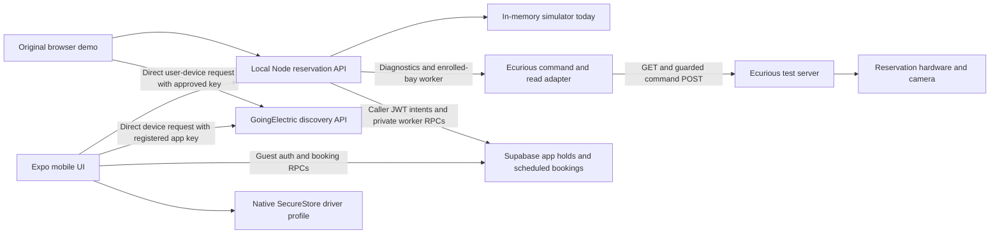

# Coding and integration guide

For the full architecture, screen flows, allocation domains and design decisions, read [SYSTEM-DESIGN.md](SYSTEM-DESIGN.md). Exact HTTP/RPC contracts are in [API.md](API.md), storage/transaction rules in [DATABASE.md](DATABASE.md), and setup/recovery in [OPERATIONS.md](OPERATIONS.md).

The [challenge workflow](CHALLENGE-WORKFLOW.md) gives concrete implementation suggestions for all twenty guiding questions in the PDF, with implemented/proposed distinctions. The [multi-car lab](MULTI-CAR-SIMULATION.md) rehearses selected cases. [Plate integration](MODEL-INTEGRATION.md) uses Ecurious's native latest-OCR endpoint; an external model is optional. [Native API tests](NATIVE-OCR-TEST.md) exercise matching and whitelist contracts without physical commands. [Privacy readiness](PRIVACY.md) documents Ecurious as intended operator and the controls and operator decisions still needed before claiming GDPR compliance.

The primary application is Expo mobile, with direct GoingElectric discovery and Supabase app holds. The local Node server hosts the independent simulator, read-only hardware diagnostics and a guarded designated-bay command worker. That worker is implemented but commands remain off by default until hosted setup, private credentials, confirmed enrollment/interlocks and an allowlist are ready. Charging remains simulated; scheduled hardware entry now uses private fresh plate matching and sensor-confirmed arrival/departure, with physical verification still pending. See [hardware setup](HARDWARE-SETUP.md), [bay lifecycle](BAY-LIFECYCLE.md) and [actual provider observations](ECURIOUS-API.md).

## Architecture

GoingElectric location/connector data and Ecurious bay occupancy have different sources. Add an explicit mapping from the mentor-confirmed station/EVSE/bay to the designated test hardware. Never turn a directory app slot into a physical command merely because it appears nearby.

The opening map uses Supabase for two separate application allocation domains: shared virtual slots for listed GoingElectric plugs, and administrator-approved location/bay/connector inventory. The schema and anonymous/email authentication are configured in the supplied hosted project; exact deployment evidence is in BUILD-LOG.md. See [Supabase setup and reservation flow](SUPABASE.md). BayReady holds are application state, not physical occupancy or an Ecurious command acknowledgement. The fictional demo inventory is separate from the explicitly enrolled barrier-only `lock-0002` interface (`BARRIER_TEST`, 0 kW, no charger). Both Supabase domains are independent of the original simulator at `/reserve`.

The normalized registered inventory is `charging_locations` → `bookable_bays` → `bay_connectors`. A reservation records its selected connector but locks the whole bay. Directory groups instead generate opaque virtual slot references for `directory_plug_reservations`. A fresh successful hold query makes an absent app hold unreserved; a stale/failed query leaves status unknown. A slot hold excludes another BayReady booking for that slot, without inventing physical identity or vacancy. Public locations are shown by default; fictional test inventory is opt-in. First-launch profile data stays in device SecureStore; its connector preference controls filtering and its masked vehicle/mock payment appear in confirmation. Profile contacts stay local. A scheduled hardware booking sends its plate transiently to Node; Supabase stores only its keyed fingerprint and masked suffix. Optional chosen account email goes directly to Supabase Auth.

`npm start` starts Expo and binds the mock API to `0.0.0.0` for phone access. The standalone server still defaults to loopback; `npm run server:lan` intentionally exposes this local simulator to the LAN. Native fetch does not need browser CORS settings. See `mobile/README.md` for address overrides and same-network setup.

## Local API

These are **this starter's endpoints**, not Ecurious endpoints. Successful writes return the current state. Invalid input or transitions return a structured error. State includes redacted events and capability flags for UI buttons.

| Method and path | Input | Purpose |
| --- | --- | --- |
| `GET /api/health` | — | Local health and simulator mode |
| `GET /api/state` | — | Bay, reservation, deadline, capabilities, redacted timeline |
| `GET /api/hardware` | — | Separate read-only Ecurious assignment/telemetry; no raw plates or images |
| `POST /api/reservations` | `{ "plate": "M-DEMO-42", "holdMinutes": 10 }` | Reserve the single simulated bay |
| `POST /api/actions` | `{ "action": "arrive", "plate": "M-DEMO-42", "confidence": 0.99 }` | Simulated camera/arrival input |
| `POST /api/actions` | `{ "action": "start-charge" }` | Simulated charging state only |
| `POST /api/actions` | `{ "action": "depart" }` | Simulated vehicle departure |
| `POST /api/actions` | `{ "action": "release" }` | Finish/cancel when allowed |
| `POST /api/actions` | `block`, `clear`, `expire`, or `reset` as `action` | Simulator scenario controls |

The simulator's authorization transition lowers its virtual barrier before recording authorized occupancy. Live command sequencing must follow the hardware's actual interlocks and the mentor's instructions.

`GET /api/hardware` calls the supplied challenge service using `X-API-Key` from the backend environment. It projects permitted telemetry fields rather than forwarding upstream objects. Plate lists and photos are omitted; only camera-policy mode/count and recognition presence/time are returned. No key means `configured: false` with an empty lock list. Upstream failures return fixed, sanitized errors. Requests have a six-second timeout, a 1 MiB response limit, and reject redirects. `npm run hardware:inspect` uses this same adapter without starting the app.

The local freshness window is 60 seconds, a display policy rather than a verified safety threshold. Offline, unknown, missing, future-dated or old telemetry never becomes current vacancy or barrier position. The mobile panel also ages out retained snapshots and marks state unknown after refresh failures. Service response time and the provider's `lastSeenAt` remain separate. The app does not consume SSE yet: a bounded probe received only `connected`, and the public reference disagrees with dashboard listener names.

## Guarded hardware integration

The adapter implements authenticated reads and `raiseBarrier`/`lowerBarrier`. Each movement sends one POST and returns an acknowledgement with `confirmed:false`. Ambiguous `reserve`/`release` adapter methods still refuse: application ownership and sequencing belong in the durable backend workflow. The fifth migration adds scheduled bay windows and private plate matching; see [scheduled sessions](SCHEDULED-SESSIONS.md).

The dedicated `/hardware` screen uses authenticated Node booking/action routes. Registered Ecurious bays are excluded from the generic demo map inventory RPC and require operator enrollment; no public station is automatically assigned hardware. See [API.md](API.md) for routes and [DATABASE.md](DATABASE.md) for transaction/role rules.

The worker validates team assignment, allowlist, current mapping, fresh vacant/stable telemetry, known fault reporting and operator-confirmed configuration before a movement. Protection also requires plate auto-access disabled. A short fenced claim can be replaced before dispatch; a committed dispatch permit is never retried or reclaimed. Freshness is checked again after the permit response. Only a durable acknowledgement and a strictly newer target observation can confirm a dispatched movement. Matching pre-existing state can complete a claimed operation without a POST.

No-ACK uncertainty stays quarantined even when a later GET matches, because a paused process could still send late. Recovery requires stopping dispatchers and inspecting/reconciling the hardware. Cancellation and expiry record cleanup intent and retain the whole-bay hold until confirmed vacant/lowered cleanup. A newer occupied report rejects an older vacant permit; conflicting same-time observations require a newer sample. The API provides no documented external fencing/idempotency, so the software does not promise exactly-once physical delivery.

Activation steps and operator recovery are in [HARDWARE-SETUP.md](HARDWARE-SETUP.md). The user selected barrier-only `lock-0002`, relayed operator confirmations and confirmed exclusive use. A direct raise/lower test and later worker cleanup received acknowledgements followed by newer matching device reports. After a telemetry pause, a genuine fresh vacant/lowered report at **14:22:21.966 UTC** reconciled the bay to idle and restored activation. Successful HTTP reads do not refresh the provider's sensor timestamp; subsequent old reports still produce `TELEMETRY_UNKNOWN`. A queued booking is not physical protection. Native OCR entry and the complete customer cycle remain unverified, and this rig supplies no charging telemetry. Keep the simulator's arbitrary arrival controls separate from actual camera/sensor events and record observed evidence in [BUILD-LOG.md](BUILD-LOG.md).

## Product rules to discuss with the team

- Current requested policy is Now/free ten minutes, €1 mock additions, and €1 mock scheduled arrival with protection from T−10 until T+10. A timely accepted match ends unused-hold expiry. These prices/timing are prototype choices, not measured optimal policies. The original single-bay simulator has its own independent ten-minute hold.
- A plate match plus sufficient confidence permits the arrival path in the simulator. An uncertain/mismatched result needs a corrected observation or an operator fallback, not an automatic rejection fee.
- An occupied bay is unavailable for a new reservation. If a held bay becomes blocked, show that problem, preserve the booking context, and offer operator escalation or another verified reservable bay once such alternatives exist.
- No-show expiry may end a hold when no authorized arrival occurred. A missing plate event does not establish that the bay is empty. Occupancy interlocks must govern physical movement; occupied/unknown state requires safe recovery.
- Charging evidence must come from the source agreed with organisers. “Start simulated charge” changes local state only.

## GoingElectric discovery integration

The mobile Map tab uses `react-native-maps` and `mobile/src/lib/goingelectric-api.ts` for direct viewport queries. Root launchers load the registered directory key from `.env` and pass only that key as `EXPO_PUBLIC_GOINGELECTRIC_API_KEY`; they remove the hardware key from the Expo child environment. The directory key is accessible on the phone and must stay out of tracked files and shared build artifacts. No directory catalog goes through the Node server. Native station data has a one-hour memory lifetime and visible source/time/entry links. Software slot holds store booking references separately; no physical mapping is inferred. Optional foreground location centers the viewport only after a user tap. Expo Go supplies its native map setup; an independently built Android binary needs its own configured Google Maps SDK key, separate from both provider keys. [Expo map documentation](https://docs.expo.dev/versions/latest/sdk/map-view/).

The original browser rehearsal optionally uses `https://api.goingelectric.de/chargepoints/` with `key`, `lat`, `lng`, and integer `radius`. The native client uses a bounding box instead. Both render `chargelocations` and connector data. Keys are not baked into the repository. Directory results stay separate from the Node simulated bay. [Official API documentation](https://www.goingelectric.de/stromtankstellen/api/docs/).

The published terms restrict use to the registered app, require direct retrieval from the end user's device, limit device retention to 24 hours, and require source attribution and a per-entry link. Directory browsing remains accessible without completing a profile or successfully signing into bookings. Cross-device station/opaque-slot booking references are an unresolved provider/mentor clarification: the terms give no explicit exemption for hashes or derived IDs. Do not claim permission merely because no full catalog is stored, or work around failed CORS with a server proxy. [Official API terms](https://www.goingelectric.de/stromtankstellen/api/terms/), rechecked 24 October 2026.

## Plate data and practical limits

Use fictional plates for preparation. The simulator keeps a keyed fingerprint and masked display rather than retaining the submitted raw plate. Inputs still pass through browser and server memory; a keyed fingerprint is pseudonymous data, not proof of anonymisation or GDPR compliance. The requested full driver profile, including plate, stays in native SecureStore. Prepared Supabase tables store app hold metadata and registered inventory, without raw plates or camera images. Live data handling, access, notices, retention, event payloads, and hardware-side retention need to be agreed with the organisers.

The original simulator and multi-car lab routes are unauthenticated local rehearsal controls. They have no real payment or production booking authority and must not be exposed as a public service. Separate hardware owner intents use Supabase JWTs and durable private worker state. Keep simulator overrides separate from deployed customer routes.
