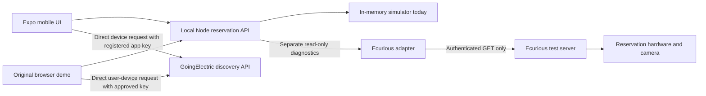

# Coding and integration guide

The primary application is an Expo mobile app in `mobile/`, connected over HTTP to the in-memory Node simulator. The original browser demo remains in `public/`. A separate backend-only Ecurious adapter now provides real read-only hardware diagnostics in Activity. Reservation and charging writes remain simulated; live mode is unavailable. The app must not report a physical action as complete on the strength of a UI click or an unconfirmed command response. See [the actual API contract and observations](ECURIOUS-API.md).

## Architecture

GoingElectric location/connector data and Ecurious bay occupancy have different sources. Add an explicit mapping from the mentor-confirmed station/EVSE/bay to the designated test hardware. Never enable reservations on arbitrary directory results merely because they appear nearby.

`npm start` starts Expo and binds the mock API to `0.0.0.0` for phone access. The standalone server still defaults to loopback; `npm run server:lan` intentionally exposes this local simulator to the LAN. Native fetch does not need browser CORS settings. See `mobile/README.md` for address overrides and same-network setup.

## Local API

These are **this starter's endpoints**, not Ecurious endpoints. Successful writes return the current state. Invalid input or transitions return a structured error. State includes redacted events and capability flags for UI buttons.

| Method and path | Input | Purpose |
| --- | --- | --- |
| `GET /api/health` | — | Local health and simulator mode |
| `GET /api/state` | — | Bay, reservation, deadline, capabilities, redacted timeline |
| `GET /api/hardware` | — | Separate read-only Ecurious assignment/telemetry; no raw plates or images |
| `POST /api/reservations` | `{ "plate": "M-DEMO-42", "holdMinutes": 10 }` | Reserve the single simulated bay |
| `POST /api/actions` | `{ "action": "arrive", "plate": "M-DEMO-42", "confidence": 0.99 }` | Simulated camera/arrival input |
| `POST /api/actions` | `{ "action": "start-charge" }` | Simulated charging state only |
| `POST /api/actions` | `{ "action": "depart" }` | Simulated vehicle departure |
| `POST /api/actions` | `{ "action": "release" }` | Finish/cancel when allowed |
| `POST /api/actions` | `block`, `clear`, `expire`, or `reset` as `action` | Simulator scenario controls |

The simulator's authorization transition lowers its virtual barrier before recording authorized occupancy. Live command sequencing must follow the hardware's actual interlocks and the mentor's instructions.

`GET /api/hardware` calls the supplied challenge service using `X-API-Key` from the backend environment. It projects permitted telemetry fields rather than forwarding upstream objects. Plate lists and photos are omitted; only camera-policy mode/count and recognition presence/time are returned. No key means `configured: false` with an empty lock list. Upstream failures return fixed, sanitized errors. Requests have a six-second timeout, a 1 MiB response limit, and reject redirects. `npm run hardware:inspect` uses this same adapter without starting the app.

The local freshness window is 60 seconds, a display policy rather than a verified safety threshold. Offline, unknown, missing, future-dated or old telemetry never becomes current vacancy or barrier position. The mobile panel also ages out retained snapshots and marks state unknown after refresh failures. Service response time and the provider's `lastSeenAt` remain separate. The app does not consume SSE yet: a bounded probe received only `connected`, and the public reference disagrees with dashboard listener names.

## Implement the real adapter in this order

1. Read `lib/ecurious-adapter.mjs` and `docs/ECURIOUS-API.md`. Authenticated list, individual status and redacted latest-recognition reads are implemented; reserve/release still refuse. These internal method names are not provider booking resources.
2. Add server-side configuration for the documented URL, authentication, bay ID, and timeouts. Keep credentials out of browser bundles, logs, URLs, and tracked files. `npm start`, `npm run dev`, and `npm run doctor` load an optional `.env`; `.env.example` contains no credentials.
3. Verify read-only diagnostics against reconnected hardware. Preserve unknown/stale state and observation time. Distinguish occupancy, barrier position, booking status, and charging evidence.
4. Implement reserve/cancel or release using the **documented meanings**. Separate an accepted command from confirmed hardware state. After a timeout, reconcile status before retrying; use documented idempotency support where available.
5. Consume the actual plate event feed. Validate its source, reject duplicate/out-of-order events, correlate bay and booking, and keep confidence/manual fallback visible. Do not expose the simulator's arbitrary `arrive` endpoint as a trusted live camera feed.
6. Wire a live reservation service to the adapter; replacing the empty adapter file alone does not make the current simulator live. Remove the startup refusal only after the service, capabilities, UI labels, and event source are genuinely connected.
7. Use the hardware/server as the authority for competing bookings and occupancy. A single Node process is only sufficient for the local demo. Production needs persistent bookings, atomic concurrency control, restart recovery, authenticated actors, and reconciled background expiry.
8. Record a full live cycle and two edge cases in `BUILD-LOG.md`. Distinguish real sensor evidence from simulated inputs in the pitch.

## Product rules to discuss with the team

- Start with a short immediate-arrival reservation, a visible deadline, and free cancellation before expiry. The local 10-minute hold is a demo default, not an evidence-based policy or a separately implemented grace period.
- A plate match plus sufficient confidence permits the arrival path in the simulator. An uncertain/mismatched result needs a corrected observation or an operator fallback, not an automatic rejection fee.
- An occupied bay is unavailable for a new reservation. If a held bay becomes blocked, show that problem, preserve the booking context, and offer operator escalation or another verified reservable bay once such alternatives exist.
- No-show expiry may end a hold when no authorized arrival occurred. A missing plate event does not establish that the bay is empty. Occupancy interlocks must govern physical movement; occupied/unknown state requires safe recovery.
- Charging evidence must come from the source agreed with organisers. “Start simulated charge” changes local state only.

## GoingElectric browser integration

The mobile Map tab uses `react-native-maps` and `mobile/src/lib/goingelectric-api.ts` for direct viewport queries. Root launchers load the registered directory key from `.env` and pass only that key as `EXPO_PUBLIC_GOINGELECTRIC_API_KEY`; they remove the hardware key from the Expo child environment. The directory key is accessible on the phone and must stay out of tracked files and shared build artifacts. No directory data goes through the Node server. Native station data has a one-hour memory lifetime, visible source/time/entry links, and no reservation mapping. Optional foreground location centers the viewport only after a user tap. Expo Go supplies its native map setup; an independently built Android binary needs its own configured Google Maps SDK key, separate from both provider keys. [Expo map documentation](https://docs.expo.dev/versions/latest/sdk/map-view/).

The optional UI uses `https://api.goingelectric.de/chargepoints/` with `key`, `lat`, `lng`, and integer `radius`. It renders `chargelocations` and their connector data. Keys are entered by the user, not baked into the repository. Directory results stay separate from the simulated bay. [Official API documentation](https://www.goingelectric.de/stromtankstellen/api/docs/).

The published terms restrict use to the registered app, require direct retrieval from the end user's device, limit device retention to 24 hours, and require source attribution and a per-entry link. Confirm the approved browser setup with mentors; do not work around failed CORS by silently introducing a server proxy. [Official API terms](https://www.goingelectric.de/stromtankstellen/api/terms/), checked 23 October 2026.

## Plate data and practical limits

Use fictional plates for preparation. The backend keeps a keyed fingerprint and masked display rather than retaining the submitted raw plate. Inputs still pass through browser and server memory; a keyed fingerprint is pseudonymous data, not proof of anonymisation or GDPR compliance. Live data handling, access, notices, retention, event payloads, and hardware-side retention need to be agreed with the organisers. The starter has no database or camera-image storage.

The local server is for a laptop rehearsal, not a hosted booking service. It has no user authentication, payments, multi-tenant isolation, durable audit history, or real background hardware control. Keep simulator override endpoints out of a live deployment.
