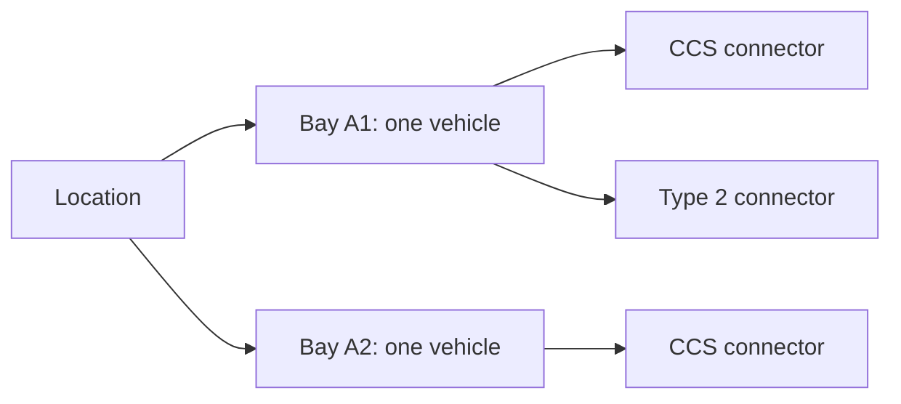

# Shared BayReady reservations

See [system design](SYSTEM-DESIGN.md), [database rules](DATABASE.md), [API contracts](API.md) and [operations](OPERATIONS.md) for the complete implementation.

The mobile app targets project `omxqhwrfnyodmscmjfqm` at `https://omxqhwrfnyodmscmjfqm.supabase.co`. Its public client key is separate from the backend Management API access token. Authorized schema setup verified at `2026-10-24T13:50:46.533Z`: all eleven migrations `20261024120000` through `20261024220000` were present with matching SHA-256 history, no migrations were pending, and the eleven application tables remained in place. The project passed the healthy-project guard. Auth was not changed by this update. Each deployment preserved the already-applied files and checksums.

**Current hardware status:** `lock-0002` is registered as `BARRIER_TEST` at 0 kW. The user relayed mentor confirmations and later confirmed exclusive team ownership. After an earlier stale-telemetry pause/rejected activation, a real fresh vacant/lowered, fault-free, auto-access-disabled report at **2026-10-24T14:22:21.966Z** reconciled the bay to idle and allowed guarded reactivation. Database controls are `enabled=true`, `interlocks_confirmed=true`; root `.env` and the running backend on port 3001 agree. Subsequent old telemetry still produces `TELEMETRY_UNKNOWN`; activation never substitutes for a fresh movement preflight. Reports were about three minutes apart, so booking intent and confirmed physical protection are separate states.

The eight-version setup smoke check created one anonymous test user, verified four authenticated read RPCs (`list_bay_availability`, `list_directory_holds` including `myBookings`, `list_hardware_workflows`, `list_my_hardware_slots`), verified five denials covering the private hardware tables, both extension ledgers and the private work-list RPC, and deleted that same test user. A separate backend-key read of `list_hardware_slot_work` succeeded with empty `controls` and `slots`. A private backend project key was saved only to ignored root `.env` with permissions `0600`; later applies preserved it. Setup sent no email, reservation, real charge, hardware enrollment, worker activation, or Ecurious command. Two-phone interaction, an Android preview, and the physical hardware cycle have not been verified by these checks.

At `2026-10-24T12:24:28.829Z`, authorized functional debugging used one new anonymous user and a fictional station/opaque slot to complete **Now → extend → cancel** and **scheduled → cancel** against hosted PostgREST. Every request returned HTTP 200 and every booking/snapshot passed the actual mobile contract validator. The scheduled booking appeared only in owner `myBookings` before its protection window; current holds and owned bookings were empty after cancellation. The test identity was deleted, and a private count query verified zero remaining directory booking/extension rows for that identity. The configured phone project/public-key claims and authenticated anonymous session claims were verified. Anonymous signup was enabled at 30 per IP per hour; no 429 occurred. This establishes hosted directory functionality, while device interaction still needs its own verification. No real directory resource, profile, payment or hardware was used.

The ninth deployment applied only `20261024200000` after the focused arrival-grace SQL contract passed. Read-only verification confirmed exact nine-version history and `protectionDeadlineAt` in the deployed hardware/private-work/directory projection definitions. The private work-list returned HTTP 200 with empty `controls` and `slots`; there were no real rows on which to observe a deadline value. An optional synthetic-claim directory SQL read was rejected by the Management API with HTTP 400 and remains unverified. No migration retry, new guest, Auth reconfiguration, enrollment or hardware command followed that failed auxiliary check. The earlier actual directory PostgREST lifecycle remains separate evidence.

The tenth deployment applied only [privacy rights](../supabase/migrations/20261024210000_privacy_rights.sql), matching the frozen SHA-256, after the focused `--privacy-only` PostgreSQL contract passed. Read-only hosted metadata verified all three privacy RPCs have no owner argument, derive `auth.uid()`, use `SECURITY DEFINER` with an empty search path, grant execution to authenticated users and deny unauthenticated `anon`. The private erasure queue has RLS enabled and no direct phone table grants; its projection helper denies execution to `anon`, `authenticated` and `service_role`. Auth settings were unchanged. No guest was created and no export, erasure intake, account deletion, booking cancellation, retention purge or hardware action was invoked during deployment. The export uses explicit own-history projections, excluding private plate fingerprints, camera event keys and credentials; opaque directory slot references and the owner's masked plate suffix are included. Large exports are not paginated. See [privacy boundaries and operator work](PRIVACY.md).

The eleventh migration, [barrier test interface](../supabase/migrations/20261024220000_barrier_test_interface.sql), passed `--barrier-test-only` in isolated PostgreSQL before its tenth-to-eleventh guarded delta. It permits an explicit `BARRIER_TEST` interface at exactly 0 kW while actual charger types require positive power; the disabled historical `UNKNOWN` placeholder remains representable. It adds no table, RPC or inventory seed and performs no provider call.

After a default read-only preview returned `CREATE_DISABLED_TEST`, the authorized enrollment script atomically created the user-selected `lock-0002` inventory and verified both control gates false. It used location `b2a00000-0000-4000-8000-000000000002` labelled **Ecurious barrier-only test**, bay `b2a00000-0000-4000-8000-000000000102`, and interface `b2a00000-0000-4000-8000-000000000202` labelled **Barrier test interface · no charger**, type `BARRIER_TEST`, 0 kW. No GoingElectric mapping or coordinates were supplied. The focused enrollment test covered atomic creation/reuse and refusal of enabled controls, real-connector conflicts, partial setups and checksum drift.

The operator subsequently recorded the user's confirmed interlock facts with `interlocks_confirmed=true` while retaining `enabled=false`. Read-only verification at `2026-10-24T13:53:49.355757Z` observed that state, phase `idle`, no reservation/current operation, and zero rows in both `hardware_operations` and `hardware_slot_bookings`. Enrollment did not overwrite the later operator fact. Schema/enrollment made no provider request and did not activate automatic control. These database facts do not establish a physical cycle; any separately authorized bench-test evidence belongs in the build log.

Later separately authorized direct API calls reported raised/vacant at `2026-10-24T13:54:55.309Z`, then lowered/vacant at `13:54:59.709Z`, with newer telemetry and no reported errors. The first whitelist clear was verified, but other users subsequently restored rules. After the user confirmed exclusive team ownership, a second clear was followed by four disabled-mode readbacks over fifteen seconds. A guarded **idle** release then dispatched through the worker at `14:01:41Z` and recorded confirmation at `14:01:45.502842Z`; the earlier zero-operation count is historical. These observations establish direct setup results and one worker cleanup, not a complete customer booking/matching-plate/occupied-arrival/departure cycle or any real charging. The current stale/blocked state is recorded above; all durable confirmation and freshness guards remain enforced. See [hardware evidence and activation](HARDWARE-SETUP.md) and [the build log](BUILD-LOG.md).

The enrollment command defaults to preview and accepts only the selected lock:

```sh
node --env-file-if-exists=.env scripts/enroll-hardware-test.mjs --lock-id lock-0002
```

Its explicit write form is `--apply --lock-id lock-0002`. It requires all eleven hosted checksums, repeats its mapping/idle checks inside a transaction, and creates no other inventory. Exact untouched disabled setup can be reused. Once an operator changes a gate or uses the bay, the command refuses that changed setup rather than resetting it. It never enables controls, confirms interlocks or contacts Ecurious.

The first deployment committed all five migrations and the Auth update, but its immediate Auth read-back did not yet show the requested flags. Read-only inspection confirmed both flags and unchanged email settings before continuing; no migration body or Auth PATCH was repeated. Setup now uses bounded read-only polling after a single Auth PATCH to allow for this metadata propagation delay.

## Guarded hosted setup script

From the repository root, inspect first:

```sh
node --env-file-if-exists=.env scripts/setup-supabase.mjs --inspect
```

This prints only the pinned project reference/status, Auth booleans, selected schema object names and migration versions. It uses the backend token without printing credentials, SQL statements, user data, or provider error bodies. The script refuses another project origin, redirects, unexpected migration versions, untracked application tables, missing history/checksums, and altered already-applied files.

After pending migrations pass their relevant local database checks and final review, apply the already-authorized setup:

```sh
node --env-file-if-exists=.env scripts/setup-supabase.mjs --apply
```

The script requires ordered versions `20261024120000` through `20261024220000`; it refuses apply while any reviewed migration is absent. Pending SQL and its `supabase_migrations.schema_migrations` history plus private SHA-256 ledger commit in one transaction under a project setup advisory lock. It does not rerun/adopt an existing migration without its matching checksum. The ledger contains versions/checksums, not application records, and direct mobile access is revoked. A changed remote history between inspection and dispatch aborts the transaction. The ninth–eleventh deployments reused these exported guards for migration-only transactions and read-only checks, without invoking the initial Auth/guest setup flow.

After schema verification, setup enables `external_anonymous_users_enabled` and `security_manual_linking_enabled`, permits the requested signup flow, and verifies those flags with at most seven read-back inspections. A propagation delay never triggers another PATCH. Existing email-provider and email-confirmation settings must remain unchanged. Manual linking supports upgrading an anonymous identity while preserving its user ID. [Management Auth configuration](https://supabase.com/docs/reference/api/v1-update-auth-service-config), [anonymous identity upgrades](https://supabase.com/docs/guides/auth/auth-anonymous).

Only after successful schema/Auth setup may the script retrieve an existing project secret/service-role key and save it to the ignored root `.env` as `SUPABASE_SECRET_KEY` or `SUPABASE_SERVICE_ROLE_KEY`. It creates no API key and prints no key value. The replacement environment file uses permissions `0600` and checks for a concurrent content change before replacement. Existing usable backend key configuration is preserved. Public/publishable client keys alone never authorize worker RPCs, and Management/private keys must never enter Expo. [Management key retrieval](https://supabase.com/docs/reference/api/v1-get-project-api-keys).

The authorized post-apply smoke check creates one anonymous test user with no contact/profile data, calls the four availability/directory/hardware/calendar read RPCs with that user's session, verifies denial of direct access to both private hardware tables, both extension ledgers and the private work-list RPC, then deletes only that newly created test identity with the backend key. A separate backend-key read verifies the private work-list RPC and the expected empty hardware state. Output records verification booleans/counts; no user ID, session or token is printed or saved. It sends no email, creates no reservation and performs no hardware command. A failing smoke check is surfaced; schema/Auth changes already committed must be inspected rather than automatically rolled back or repeated.

Network failures are not retried automatically: the database or Auth update may have committed. Run `--inspect` and reconcile before another apply. Schema/history/checksum guards support a safe later continuation. Management SQL queries use the documented `read_only` flag for inspection; apply uses the write-capable query endpoint for the authorized transaction. [Management query reference](https://supabase.com/docs/reference/api/v1-run-a-query).

Hosted schema application and key retrieval **do not enroll hardware, change Ecurious access policies, send barrier commands, or enable the worker**. The reviewed physical mapping, interlock confirmation, private plate configuration and explicit backend activation remain separate steps in [HARDWARE-SETUP.md](HARDWARE-SETUP.md).

## Apply the prepared setup

1. Apply the migrations in order: [initial booking schema](../supabase/migrations/20261024120000_bayready_reservations.sql), [location/bay/connector hierarchy](../supabase/migrations/20261024130000_location_bay_connectors.sql), [directory app slot holds](../supabase/migrations/20261024140000_directory_plug_holds.sql), [guarded hardware workflow](../supabase/migrations/20261024150000_hardware_workflow.sql), [scheduled hardware slots](../supabase/migrations/20261024160000_scheduled_hardware_slots.sql), [plate arrival deadline](../supabase/migrations/20261024170000_plate_arrival_deadline.sql), [hardware booking options](../supabase/migrations/20261024180000_booking_options.sql), [directory booking options](../supabase/migrations/20261024190000_directory_booking_options.sql), [arrival grace](../supabase/migrations/20261024200000_arrival_grace.sql), [privacy rights](../supabase/migrations/20261024210000_privacy_rights.sql), then [barrier test interface](../supabase/migrations/20261024220000_barrier_test_interface.sql). Prefer the guarded script after relevant local validation; a manual deployment needs equivalent history reconciliation. Earlier files preserve inventory/holds and add default-disabled durable hardware workflows. The seventh/eighth add fixed Now/calendar options and private extension ledgers in their separate physical/software domains. The ninth separates planned arrival from the unused protection deadline: arrival 15:00 protects from 14:50 and times out unused at 15:10, plus explicit extensions. A trusted accepted plate match exits automatic unused timeout; sensor-confirmed occupancy/departure remains separate. These migrations enroll no real bay and send no provider commands. Never rerun an applied migration or reset project data.
2. Enable Anonymous Sign-Ins and manual identity linking through the guarded Auth setup. This creates a separate authenticated guest identity per installation without an email/password form and permits its later verified upgrade. It differs from simply using an anon API key. Existing email verification remains enabled. [Supabase anonymous auth](https://supabase.com/docs/guides/auth/auth-anonymous).
3. The root `.env` already has the supplied `SUPABASE_API_KEY` and configured `SUPABASE_URL`. A new publishable key can instead use `SUPABASE_PUBLISHABLE_KEY`. Root launchers pass only public settings into Expo and reject a secret/service-role key. No administrator token belongs in a mobile variable. [Supabase key types](https://supabase.com/docs/guides/getting-started/api-keys).
4. Restart `npm start`. The map restores or starts a guest session and overlays active holds on direct directory results. Select one listed plug and confirm a software hold: a second phone must lose a competing request for that same slot while other slots remain unreserved. Cancel or wait for the server deadline, then refresh. Separately, enable **Show test location** to inspect the fictional registered inventory: holding either connector on A1 must block both plugs on that bay.

The deployed schema/Auth passed backend verification. The app still requires a successful fresh read before enabling shared holds; unavailable or stale booking status remains unknown. Real directory locations remain browsable independently of booking setup. No local fake reservation replaces an unavailable database.

## Data model and authority

| Object | Purpose |
| --- | --- |
| `public.charging_locations` | Administrator-approved site: label, optional confirmed GoingElectric ID, and operator-provided/demo coordinates |
| `public.bookable_bays` | Physical one-vehicle spaces belonging to a location, with integration mode and optional hardware lock ID |
| `public.bay_connectors` | Identified bay interfaces: positive-power real connectors or an explicit zero-power `BARRIER_TEST` with no charger claim |
| `public.booking_reservations` | Owner, bay, selected connector, server timestamps, hold state, and request UUID for idempotency |
| `public.directory_plug_reservations` | Separate software holds on station ID/opaque virtual slot references; no copied directory catalog |
| `public.directory_plug_extensions` | Private owner/request ledger for idempotent ten-minute software extensions with mock fees |
| `public.hardware_controls`, `public.hardware_operations` | Private enrolled-bay recovery guard and durable command ledger; default-disabled, no real seed |
| `public.hardware_slot_bookings` | Whole-bay scheduled windows, HMAC/masked plate, arrival/departure observations and explicit billing-state markers; no raw plate or payment capture |
| `public.hardware_slot_extensions` | Private idempotency ledger for hardware booking extensions; no payment capture |
| `public.privacy_erasure_requests` | Private one-per-owner pending-review erasure intake; no automatic deletion or cancellation |
| `list_bay_availability()` | Registered inventory and current BayReady holds; another user's identity/reservation ID is omitted |
| `reserve_bay(p_bay_id, p_hold_minutes, p_request_id, p_connector_id)` | Atomically hold a specific plug and its whole bay, or return the same earlier request result |
| `cancel_reservation(p_reservation_id)` | Cancel only the caller's own hold; repeated cancellation is safe |
| `list_directory_holds(p_station_ids)` | Current software protection for up to 500 stations plus owned current holds; `myBookings` separately restores every owned current/future booking |
| `reserve_directory_booking(p_station_id, p_slot_key, p_booking_mode, p_starts_at, p_request_id)` | Allocate free Now ten minutes or scheduled arrival with ten minutes afterward, ten-minute software lead-in and mock €1 fee |
| `reserve_directory_plug(p_station_id, p_slot_key, p_hold_minutes, p_request_id)` | Compatible signature for the fixed free Now option; accepts only ten minutes |
| `extend_directory_booking(p_reservation_id, p_request_id)` | Owner-only extra ten minutes for mock €1; atomic conflict check and repeatable request identity |
| `cancel_directory_hold(p_reservation_id)` | Repeatable owner-only directory slot cancellation |
| `export_my_bayready_data()` | Explicit caller-owned booking/extension history and their own request status; no Auth secret or plate fingerprint |
| `request_my_data_erasure()` | Idempotent pending-review intake; data and active allocations remain intact |
| `get_my_privacy_request()` | The caller's own pending request, or null |

There is no imported GoingElectric catalog, address/connector cache, raw plate, or camera image in this schema. Directory requests remain direct from the phone. A station can have multiple bays; each inventory row represents one reservable bay. An optional station ID is an explicit mapping, not automatic permission to control public infrastructure.

The test seed is one **fictional Berlin location** at `52.52, 13.405`, with three bays and four plugs: A1 has CCS 150 kW and Type 2 22 kW, A2 has CCS 150 kW, A3 has Type 2 22 kW. It has no GoingElectric ID or hardware link and is hidden behind **Show test location**. Real Ecurious rows are rejected by generic `reserve_bay` and excluded from generic inventory. They use the dedicated guarded workflow and operator enrollment described in [HARDWARE-SETUP.md](HARDWARE-SETUP.md). The existing `/reserve` simulator is a separate rehearsal flow; its controls do not modify Supabase holds.



A connector selection stores its own ID, but a reservation holds the whole bay. A composite foreign key prevents booking a connector from another bay. An old hold whose connector was not recorded receives a disabled `UNKNOWN` placeholder during migration; its ID, owner, deadline and request history are preserved without guessing which plug was used.

“Unreserved” means **no active BayReady booking**. It does not establish vacancy, working charging hardware, or the absence of another operator's booking. Real GoingElectric locations are visible by default, with listed plug counts and unknown physical availability. Registered inventory is grouped into one marker per location, showing compatible bay and plug counts separately. Listed app plugs can receive independent software holds; registered bay holds additionally block every plug on their bay. Reported faults and active reservations remain filter controls. A displayed countdown reaching zero does not make a bay available locally: the app waits for a database read.

A directory entry such as `4 × CCS` expands into four **listed app slots**. After a complete fresh database read, absent current holds mean unreserved in BayReady now; a later scheduled window may still conflict. Holding slot 2 prevents another BayReady user from allocating an overlapping software window for that slot; slots 1, 3 and 4 remain independently allocatable. Unused slots need no preinserted inventory rows.

Public slots offer **Reserve now** for ten free minutes or **Schedule arrival** within seven days for a mock €1, ending ten minutes after arrival and allocating software protection from ten minutes before arrival. These windows never control public equipment. **Extend** adds ten minutes and a mock €1 only if the next software window permits it; eleven extensions are allowed. Calendar bookings belong in `myBookings` until their protection begins, when they also appear in current `holds`. Current and future owner bookings remain cancellable outside the viewport. A fee/payment marker records the demonstration option; no payment processor, card charge or physical guarantee exists.

Identical type/power groups are merged. A versioned station/type/power SHA-256 prefix plus a one-based ordinal creates the opaque key; labels, coordinates, type/power/count and profiles are not sent to the hold RPC. Group order changes preserve identities; changed metadata or reduced counts can orphan earlier keys. Owned active holds remain cancellable outside the viewport or current catalog. SQL validates reference format, not directory authenticity or capacity: a modified client can invent slots.

These virtual numbers do not establish physical plug IDs, bay assignments, simultaneous charging capacity, occupancy or operator booking rights. Provider terms contain no explicit exemption for hashes/derived IDs; cross-device booking references still need provider/mentor clarification. See [integration boundaries](INTEGRATION.md).

## Concurrency and access

All eleven application tables have RLS enabled and direct client table grants revoked. Phones use only narrow authenticated RPCs. Public booking/privacy functions have an empty search path, require `auth.uid()`, restrict owner actions, and return only projected fields. Private projection helpers and worker functions have separate revoked/restricted execution grants. A public client key cannot edit inventory, read reservation ownership rows, or use unauthenticated booking/privacy RPCs. [Supabase API access controls](https://supabase.com/docs/guides/api/securing-your-api).

The generic demo transaction locks its target bay, validates its connector, expires earlier holds using database time, and checks availability before inserting; its partial unique index also guards whole-bay allocation. Directory booking/extension transactions share a station/slot advisory lock. Their GiST exclusion constraint rejects overlapping held `[protectionStartsAt, expiresAt)` windows, including an extension into a later calendar lead-in; adjacent windows fit. Per-owner locks and owner/request UUIDs deduplicate intent; a reused request for different resource/mode/arrival is rejected. Extension ledgers prevent duplicate deadline/fee increments. Reserve/cancel/extend requests disable SDK retries; successful and uncertain results both trigger a fresh current/future snapshot.

## First-time driver profile

On first launch, `/profile` collects name, email, international phone number, license plate, preferred connector and a mock payment option. **Explore map first** keeps directory browsing accessible without entering personal details. Saving a profile is required before confirming a new app hold; an existing hold can still be cancelled.

The profile is stored locally in native SecureStore, with separate schema/version validation and onboarding state. Its contact details and complete profile object are not uploaded to booking tables or providers. Directory and demo holds send no plate. A dedicated hardware-slot request can submit the chosen plate to the backend for HMAC comparison; SQL stores a keyed fingerprint and masked suffix. Private provider whitelist programming, when explicitly enabled, necessarily sends the selected normalized plate to that hardware service and must follow the separate retention/access agreement. Profile contact fields are not verified email/SMS credentials; optional account authentication is a separate flow. The mock payment preference has no card-number/CVV input, processor or charge. A web preview retains profile data in memory only. Storage errors do not overwrite unreadable data, and a failed save keeps the form draft.

The preferred connector (`CCS`, `Typ2` or `CHAdeMO`) automatically filters directory queries and individually registered plugs. Minimum power remains a separate dropdown choice. Profile editing returns to the existing map to retain that manual power setting. Confirmation shows a masked plate and mock payment. Directory booking RPCs receive only station/opaque-slot references, mode/optional arrival and request UUID; generic registered demo holds receive bay/connector IDs, duration and request UUID. Neither path uploads the profile.

The fictional registered demo retains its 5/10/15-minute controls; public directory slots use the two fixed options above. Hardware bookings use their separately guarded Now/calendar flow. Guest sessions persist in serialized SecureStore chunks on Android. A web preview uses memory only. Foreground reads run every ten seconds; a 25-second local read-age policy pauses actions on stale status. These are application connection rules, not sensor safety thresholds.

## Verify without touching the hosted project

```sh
npm test
npm run check
npm run test:database
```

The database check requires Docker and the public `postgres:17-alpine` image locally. It starts an isolated container with no network, no published port, and temporary storage; creates test-only Supabase auth shims; applies all eleven migrations; runs historical contracts at their relevant migration boundaries, then the [hardware booking-options](../supabase/tests/booking_options_contract.sql), [directory options](../supabase/tests/directory_options_contract.sql), [arrival-grace](../supabase/tests/arrival_grace_contract.sql), [privacy](../supabase/tests/privacy_contract.sql) and [barrier-test](../supabase/tests/barrier_test_contract.sql) contracts; verifies upgrade preservation; and races independent Postgres sessions. Races cover a bay through different connectors, directory slots, scheduled windows and identical retries. It removes its own test container afterward and reads no `.env` credentials. `node scripts/test-database.mjs --barrier-test-only` selects the eleventh migration's focused contract without repeating the historical suites.

Before the first six deployments, the full local contracts/races and setup-wrapper preservation/checksum checks passed. The seventh/eighth changes received targeted hardware/directory SQL contracts and syntax/TypeScript checks, without repeating the full suites. The directory contract covers free Now, calendar lead-in/exclusion, current/future projections, mock fees, owner checks, request retries, extension conflicts and cancellation. The ninth–eleventh passed their focused real PostgreSQL arrival-grace/privacy/barrier contracts and setup syntax; their remote checks are recorded above. Two-phone synchronization, device interaction, and actual email verification/account upgrade remain unverified by these checks. Abuse controls, retained history, account recovery, hosted backend authentication and the physical hardware cycle remain operational work.

## Suggested Reserve interaction

1. Marker opens a short card with bay/connector details and the source of booking status.
2. Reserve opens confirmation with vehicle choice when live plate integration exists, the arrival deadline, cancellation terms and any agreed price. For now it offers a clearly labelled demo hold duration and stores no plate or payment.
3. Confirm performs an atomic database allocation. Show success only after the server response; on a conflict refresh the bay instead of creating a second booking.
4. Keep the implemented server countdown and cancellation controls; reserved resources remain reachable through Filters when their markers are hidden. Directions/ETA are proposed additions, not current features.
5. A future live flow must confirm hardware protection, recognise the correct arrival, obtain agreed charging evidence, and reconcile departure/release. Ending a software hold never proves vacancy or authorizes a barrier movement.

## Dedicated hardware-backed holds

The fourth migration reuses registered bay reservations with a durable `hardware_controls` recovery guard and `hardware_operations` command history. Physical holds stay held past deadline/cancellation intent until confirmed safe cleanup. Generic demo APIs cannot bypass this guard. The operator must enroll a confirmed physical mapping, enable controls/interlocks, configure a backend-only secret key and assigned-lock allowlist, then explicitly activate the worker. Schema application alone does not enable movement.

Private worker RPC execution is restricted to `service_role`; user intent RPCs retain guest `auth.uid()` ownership checks. The private key never goes to Expo. Post-dispatch operations without a persisted acknowledgement are quarantined, even if reads match the target. No automatic command retry or deadline-based quarantine reset exists. See [database details](DATABASE.md), [hardware setup/recovery](HARDWARE-SETUP.md) and [blocked/no-show policy](BAY-LIFECYCLE.md).
