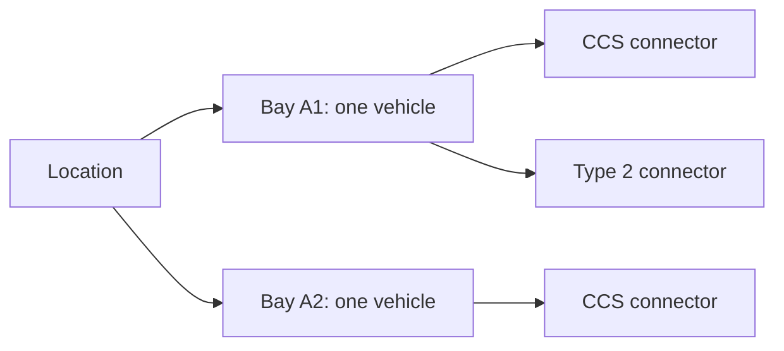

# Shared BayReady reservations

See [system design](SYSTEM-DESIGN.md), [database rules](DATABASE.md), [API contracts](API.md) and [operations](OPERATIONS.md) for the complete implementation.

The mobile app is prepared for project `omxqhwrfnyodmscmjfqm` at `https://omxqhwrfnyodmscmjfqm.supabase.co`. The supplied `.env` key is a legacy **anon client key**, matches that project, and is not expired. Its public auth settings responded successfully; anonymous sign-ins were disabled at the setup check. The cloud migration has **not been applied yet**: the client key cannot change schema or project auth settings. A connected Supabase account or administrator access is still required.

## Apply the prepared setup

1. Apply the migrations in order: [initial booking schema](../supabase/migrations/20261024120000_bayready_reservations.sql), [location/bay/connector hierarchy](../supabase/migrations/20261024130000_location_bay_connectors.sql), then [directory app slot holds](../supabase/migrations/20261024140000_directory_plug_holds.sql), through the connected Supabase migration tool or dashboard SQL editor. The second migration moves bay location fields into location rows, preserves existing holds, and replaces the reserve RPC signature. The third adds a separate software allocation domain for directory-listed app plugs. Inspect existing objects before applying; do not rerun an already-applied migration or reset project data.
2. In Authentication settings, enable Anonymous Sign-Ins. This creates a separate authenticated guest identity per installation without an email/password form. It differs from simply using an anon API key. [Supabase anonymous auth](https://supabase.com/docs/guides/auth/auth-anonymous).
3. The root `.env` already has the supplied `SUPABASE_API_KEY` and configured `SUPABASE_URL`. A new publishable key can instead use `SUPABASE_PUBLISHABLE_KEY`. Root launchers pass only public settings into Expo and reject a secret/service-role key. No administrator token belongs in a mobile variable. [Supabase key types](https://supabase.com/docs/guides/getting-started/api-keys).
4. Restart `npm start`. The map restores or starts a guest session and overlays active holds on direct directory results. Select one listed plug and confirm a software hold: a second phone must lose a competing request for that same slot while other slots remain unreserved. Cancel or wait for the server deadline, then refresh. Separately, enable **Show test location** to inspect the fictional registered inventory: holding either connector on A1 must block both plugs on that bay.

Until both schema and auth are ready, shared booking status remains unknown and writes are disabled. Real directory locations remain browsable by default; booking setup does not gate directory browsing. No local fake reservation replaces an unavailable database.

## Data model and authority

| Object | Purpose |
| --- | --- |
| `public.charging_locations` | Administrator-approved site: label, optional confirmed GoingElectric ID, and operator-provided/demo coordinates |
| `public.bookable_bays` | Physical one-vehicle spaces belonging to a location, with integration mode and optional hardware lock ID |
| `public.bay_connectors` | Individually identified plugs belonging to one bay, including type, power and enabled state |
| `public.booking_reservations` | Owner, bay, selected connector, server timestamps, hold state, and request UUID for idempotency |
| `public.directory_plug_reservations` | Separate software holds on station ID/opaque virtual slot references; no copied directory catalog |
| `list_bay_availability()` | Registered inventory and current BayReady holds; another user's identity/reservation ID is omitted |
| `reserve_bay(p_bay_id, p_hold_minutes, p_request_id, p_connector_id)` | Atomically hold a specific plug and its whole bay, or return the same earlier request result |
| `cancel_reservation(p_reservation_id)` | Cancel only the caller's own hold; repeated cancellation is safe |
| `list_directory_holds(p_station_ids)` | Active holds for up to 500 stations plus all caller-owned active holds for recovery |
| `reserve_directory_plug(p_station_id, p_slot_key, p_hold_minutes, p_request_id)` | Atomically hold one listed app slot; physical availability remains unverified |
| `cancel_directory_hold(p_reservation_id)` | Repeatable owner-only directory slot cancellation |

There is no imported GoingElectric catalog, address/connector cache, raw plate, or camera image in this schema. Directory requests remain direct from the phone. A station can have multiple bays; each inventory row represents one reservable bay. An optional station ID is an explicit mapping, not automatic permission to control public infrastructure.

The test seed is one **fictional Berlin location** at `52.52, 13.405`, with three bays and four plugs: A1 has CCS 150 kW and Type 2 22 kW, A2 has CCS 150 kW, A3 has Type 2 22 kW. It has no GoingElectric ID or hardware link and is hidden behind **Show test location**. Real Ecurious rows are rejected by `reserve_bay` until the physical workflow is implemented. The existing `/reserve` simulator is a separate rehearsal flow; its controls do not modify Supabase holds.



A connector selection stores its own ID, but a reservation holds the whole bay. A composite foreign key prevents booking a connector from another bay. An old hold whose connector was not recorded receives a disabled `UNKNOWN` placeholder during migration; its ID, owner, deadline and request history are preserved without guessing which plug was used.

“Unreserved” means **no active BayReady booking**. It does not establish vacancy, working charging hardware, or the absence of another operator's booking. Real GoingElectric locations are visible by default, with listed plug counts and unknown physical availability. Registered inventory is grouped into one marker per location, showing compatible bay and plug counts separately. Listed app plugs can receive independent software holds; registered bay holds additionally block every plug on their bay. Reported faults and active reservations remain filter controls. A displayed countdown reaching zero does not make a bay available locally: the app waits for a database read.

A directory entry such as `4 × CCS` expands into four **listed app slots**. After a complete fresh database read, absent holds mean unreserved in BayReady. Holding slot 2 prevents another BayReady user from reserving that slot until owner cancellation or server expiry; slots 1, 3 and 4 remain independently allocatable. Unused slots need no preinserted inventory rows.

Identical type/power groups are merged. A versioned station/type/power SHA-256 prefix plus a one-based ordinal creates the opaque key; labels, coordinates, type/power/count and profiles are not sent to the hold RPC. Group order changes preserve identities; changed metadata or reduced counts can orphan earlier keys. Owned active holds remain cancellable outside the viewport or current catalog. SQL validates reference format, not directory authenticity or capacity: a modified client can invent slots.

These virtual numbers do not establish physical plug IDs, bay assignments, simultaneous charging capacity, occupancy or operator booking rights. Provider terms contain no explicit exemption for hashes/derived IDs; cross-device booking references still need provider/mentor clarification. See [integration boundaries](INTEGRATION.md).

## Concurrency and access

All five tables have RLS enabled and direct client table grants revoked. Phones use only narrow authenticated RPCs. Functions have an empty search path, require `auth.uid()`, restrict cancellation to the owner, and return only projected fields. A public client key cannot edit inventory, read reservation ownership rows, or use unauthenticated RPCs. [Supabase API access controls](https://supabase.com/docs/guides/api/securing-your-api).

The reservation transaction locks its target bay, verifies that the selected enabled connector belongs to it, expires earlier holds using database time, and checks availability before inserting. A partial unique index is a second guard against two held rows for one bay, including requests for different plugs. Directory holds use a station/slot advisory lock and their own held-slot unique index. Per-owner advisory locks and unique owner/request UUIDs prevent duplicate retries or extended deadlines; they do not impose one total hold per user. Retry identity includes the resource and duration; registered holds also include the selected connector. Reserve/cancel requests disable SDK retries; uncertain outcomes trigger status reconciliation.

## First-time driver profile

On first launch, `/profile` collects name, email, international phone number, license plate, preferred connector and a mock payment option. **Explore map first** keeps directory browsing accessible without entering personal details. Saving a profile is required before confirming a new app hold; an existing hold can still be cancelled.

The profile is stored locally in native SecureStore, with separate schema/version validation and onboarding state. It is not uploaded to Supabase, GoingElectric or Ecurious, and contact details are not verified or used for email/SMS sign-in. The mock payment preference has no card-number/CVV input, processor or charge. A web preview retains profile data in memory only. Storage errors do not overwrite unreadable data, and a failed save keeps the form draft.

The preferred connector (`CCS`, `Typ2` or `CHAdeMO`) automatically filters directory queries and individually registered plugs. Minimum power remains a separate dropdown choice. Profile editing returns to the existing map to retain that manual power setting. Confirmation shows a masked plate, chosen connector and mock payment; only bay ID, connector ID, duration and request UUID go to the booking RPC.

The UI offers 5, 10 or 15 minutes; SQL accepts 1–30. Guest sessions persist in serialized SecureStore chunks on Android. A web preview uses memory only. Foreground reads run every ten seconds; a 25-second local read-age policy pauses actions on stale status. These are application connection rules, not sensor safety thresholds.

## Verify without touching the hosted project

```sh
npm test
npm run check
npm run test:database
```

The database check requires Docker and the public `postgres:17-alpine` image locally. It starts an isolated container with no network, no published port, and temporary storage; creates test-only Supabase auth shims; applies all three migrations; runs the [original](../supabase/tests/reservation_contract.sql), [hierarchy](../supabase/tests/hierarchy_contract.sql) and [directory](../supabase/tests/directory_contract.sql) contracts; verifies upgrade preservation; and races independent Postgres sessions. Races cover one bay via different connectors, the same directory slot, independent directory slots and identical request retries. It removes its own test container afterward and reads no `.env` credentials.

Local SQL checks validate the database rules, not a deployed Supabase Auth/PostgREST installation. Remote authentication, RPC permissions, two-phone synchronization, and Android UI interaction still need verification after the hosted setup is applied. Anonymous-account abuse controls, retention of expired/cancelled history, account recovery, deployment authentication, and real hardware sequencing remain decisions for a deployed service.

## Suggested Reserve interaction

1. Marker opens a short card with bay/connector details and the source of booking status.
2. Reserve opens confirmation with vehicle choice when live plate integration exists, the arrival deadline, cancellation terms and any agreed price. For now it offers a clearly labelled demo hold duration and stores no plate or payment.
3. Confirm performs an atomic database allocation. Show success only after the server response; on a conflict refresh the bay instead of creating a second booking.
4. Keep the implemented server countdown and cancellation controls; reserved resources remain reachable through Filters when their markers are hidden. Directions/ETA are proposed additions, not current features.
5. A future live flow must confirm hardware protection, recognise the correct arrival, obtain agreed charging evidence, and reconcile departure/release. Ending a software hold never proves vacancy or authorizes a barrier movement.
