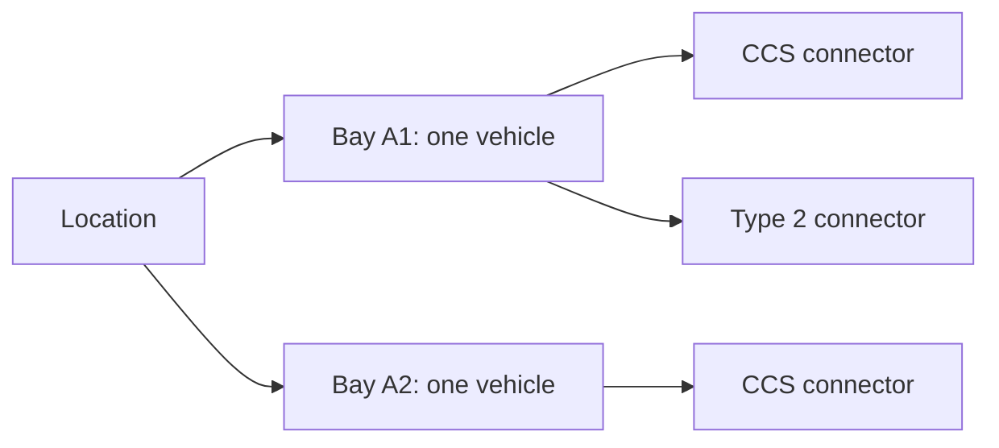

# Shared BayReady reservations

See [system design](SYSTEM-DESIGN.md), [database rules](DATABASE.md), [API contracts](API.md) and [operations](OPERATIONS.md) for the complete implementation.

The mobile app targets project `omxqhwrfnyodmscmjfqm` at `https://omxqhwrfnyodmscmjfqm.supabase.co`. Its public client key is separate from the backend Management API access token. Authorized hosted setup verified at `2026-10-24T11:59:04.792Z`: all six migrations `20261024120000` through `20261024170000` were present with matching SHA-256 history, no migrations were pending, all eight application tables existed, and the project was `ACTIVE_HEALTHY`. Anonymous sign-ins and manual identity linking were enabled; signups remained permitted, with email sign-in and email confirmation still enabled. The sixth arrival-deadline migration was applied separately without changing the first five files or checksums.

The final hosted smoke check created one anonymous test user, verified four authenticated read RPCs (`list_bay_availability`, `list_directory_holds`, `list_hardware_workflows`, `list_my_hardware_slots`), verified three denials covering both private hardware tables and the private work-list RPC, and deleted that same test user. A separate backend-key read of `list_hardware_slot_work` succeeded with empty `controls` and `slots`. A private backend project key was saved only to ignored root `.env` with permissions `0600`; the sixth apply preserved it. No email, reservation, hardware enrollment, worker activation, or Ecurious command was sent. Two-phone interaction, an Android preview, and the physical hardware cycle have not been verified by these checks.

The first deployment committed all five migrations and the Auth update, but its immediate Auth read-back did not yet show the requested flags. Read-only inspection confirmed both flags and unchanged email settings before continuing; no migration body or Auth PATCH was repeated. Setup now uses bounded read-only polling after a single Auth PATCH to allow for this metadata propagation delay.

## Guarded hosted setup script

From the repository root, inspect first:

```sh
node --env-file-if-exists=.env scripts/setup-supabase.mjs --inspect
```

This prints only the pinned project reference/status, Auth booleans, selected schema object names and migration versions. It uses the backend token without printing credentials, SQL statements, user data, or provider error bodies. The script refuses another project origin, redirects, unexpected migration versions, untracked application tables, missing history/checksums, and altered already-applied files.

After the complete six-migration set passes the local database checks and final review, apply the already-authorized setup:

```sh
node --env-file-if-exists=.env scripts/setup-supabase.mjs --apply
```

The script requires ordered versions `20261024120000` through `20261024170000`; it refuses apply while any reviewed migration is absent. Pending SQL and its `supabase_migrations.schema_migrations` history plus private SHA-256 ledger commit in one transaction under a project setup advisory lock. It does not rerun/adopt an existing migration without its matching checksum. The ledger contains versions/checksums, not application records, and direct mobile access is revoked. A changed remote history between inspection and dispatch aborts the transaction.

After schema verification, setup enables `external_anonymous_users_enabled` and `security_manual_linking_enabled`, permits the requested signup flow, and verifies those flags with at most seven read-back inspections. A propagation delay never triggers another PATCH. Existing email-provider and email-confirmation settings must remain unchanged. Manual linking supports upgrading an anonymous identity while preserving its user ID. [Management Auth configuration](https://supabase.com/docs/reference/api/v1-update-auth-service-config), [anonymous identity upgrades](https://supabase.com/docs/guides/auth/auth-anonymous).

Only after successful schema/Auth setup may the script retrieve an existing project secret/service-role key and save it to the ignored root `.env` as `SUPABASE_SECRET_KEY` or `SUPABASE_SERVICE_ROLE_KEY`. It creates no API key and prints no key value. The replacement environment file uses permissions `0600` and checks for a concurrent content change before replacement. Existing usable backend key configuration is preserved. Public/publishable client keys alone never authorize worker RPCs, and Management/private keys must never enter Expo. [Management key retrieval](https://supabase.com/docs/reference/api/v1-get-project-api-keys).

The authorized post-apply smoke check creates one anonymous test user with no contact/profile data, calls the four availability/directory/hardware/calendar read RPCs with that user's session, verifies denial of direct access to both private hardware tables and the private work-list RPC, then deletes only that newly created test identity with the backend key. A separate backend-key read verifies the private work-list RPC and the expected empty hardware state. Output records verification booleans/counts; no user ID, session or token is printed or saved. It sends no email, creates no reservation and performs no hardware command. A failing smoke check is surfaced; schema/Auth changes already committed must be inspected rather than automatically rolled back or repeated.

Network failures are not retried automatically: the database or Auth update may have committed. Run `--inspect` and reconcile before another apply. Schema/history/checksum guards support a safe later continuation. Management SQL queries use the documented `read_only` flag for inspection; apply uses the write-capable query endpoint for the authorized transaction. [Management query reference](https://supabase.com/docs/reference/api/v1-run-a-query).

Hosted schema application and key retrieval **do not enroll hardware, change Ecurious access policies, send barrier commands, or enable the worker**. The reviewed physical mapping, interlock confirmation, private plate configuration and explicit backend activation remain separate steps in [HARDWARE-SETUP.md](HARDWARE-SETUP.md).

## Apply the prepared setup

1. Apply the migrations in order: [initial booking schema](../supabase/migrations/20261024120000_bayready_reservations.sql), [location/bay/connector hierarchy](../supabase/migrations/20261024130000_location_bay_connectors.sql), [directory app slot holds](../supabase/migrations/20261024140000_directory_plug_holds.sql), [guarded hardware workflow](../supabase/migrations/20261024150000_hardware_workflow.sql), [scheduled hardware slots](../supabase/migrations/20261024160000_scheduled_hardware_slots.sql), then [plate arrival deadline](../supabase/migrations/20261024170000_plate_arrival_deadline.sql). Prefer the guarded script above after local validation; a dashboard/manual deployment needs equivalent history reconciliation. The second migration preserves holds while normalizing location/bay/connector inventory. The third adds directory app holds; the fourth adds default-disabled private hardware controls/operations. The fifth adds nonoverlapping physical-bay schedules, private plate authorization and occupancy/departure bookkeeping. The sixth requires both the recognition timestamp and current database time to precede the earlier of slot end or protection confirmation plus 15 minutes, closing entry authorization between no-show scheduler ticks. These migrations enroll no real bay and send no provider commands. Never rerun an applied migration or reset project data.
2. Enable Anonymous Sign-Ins and manual identity linking through the guarded Auth setup. This creates a separate authenticated guest identity per installation without an email/password form and permits its later verified upgrade. It differs from simply using an anon API key. Existing email verification remains enabled. [Supabase anonymous auth](https://supabase.com/docs/guides/auth/auth-anonymous).
3. The root `.env` already has the supplied `SUPABASE_API_KEY` and configured `SUPABASE_URL`. A new publishable key can instead use `SUPABASE_PUBLISHABLE_KEY`. Root launchers pass only public settings into Expo and reject a secret/service-role key. No administrator token belongs in a mobile variable. [Supabase key types](https://supabase.com/docs/guides/getting-started/api-keys).
4. Restart `npm start`. The map restores or starts a guest session and overlays active holds on direct directory results. Select one listed plug and confirm a software hold: a second phone must lose a competing request for that same slot while other slots remain unreserved. Cancel or wait for the server deadline, then refresh. Separately, enable **Show test location** to inspect the fictional registered inventory: holding either connector on A1 must block both plugs on that bay.

The deployed schema/Auth passed backend verification. The app still requires a successful fresh read before enabling shared holds; unavailable or stale booking status remains unknown. Real directory locations remain browsable independently of booking setup. No local fake reservation replaces an unavailable database.

## Data model and authority

| Object | Purpose |
| --- | --- |
| `public.charging_locations` | Administrator-approved site: label, optional confirmed GoingElectric ID, and operator-provided/demo coordinates |
| `public.bookable_bays` | Physical one-vehicle spaces belonging to a location, with integration mode and optional hardware lock ID |
| `public.bay_connectors` | Individually identified plugs belonging to one bay, including type, power and enabled state |
| `public.booking_reservations` | Owner, bay, selected connector, server timestamps, hold state, and request UUID for idempotency |
| `public.directory_plug_reservations` | Separate software holds on station ID/opaque virtual slot references; no copied directory catalog |
| `public.hardware_controls`, `public.hardware_operations` | Private enrolled-bay recovery guard and durable command ledger; default-disabled, no real seed |
| `public.hardware_slot_bookings` | Whole-bay scheduled windows, HMAC/masked plate, arrival/departure observations and explicit billing-state markers; no raw plate or payment capture |
| `list_bay_availability()` | Registered inventory and current BayReady holds; another user's identity/reservation ID is omitted |
| `reserve_bay(p_bay_id, p_hold_minutes, p_request_id, p_connector_id)` | Atomically hold a specific plug and its whole bay, or return the same earlier request result |
| `cancel_reservation(p_reservation_id)` | Cancel only the caller's own hold; repeated cancellation is safe |
| `list_directory_holds(p_station_ids)` | Active holds for up to 500 stations plus all caller-owned active holds for recovery |
| `reserve_directory_plug(p_station_id, p_slot_key, p_hold_minutes, p_request_id)` | Atomically hold one listed app slot; physical availability remains unverified |
| `cancel_directory_hold(p_reservation_id)` | Repeatable owner-only directory slot cancellation |

There is no imported GoingElectric catalog, address/connector cache, raw plate, or camera image in this schema. Directory requests remain direct from the phone. A station can have multiple bays; each inventory row represents one reservable bay. An optional station ID is an explicit mapping, not automatic permission to control public infrastructure.

The test seed is one **fictional Berlin location** at `52.52, 13.405`, with three bays and four plugs: A1 has CCS 150 kW and Type 2 22 kW, A2 has CCS 150 kW, A3 has Type 2 22 kW. It has no GoingElectric ID or hardware link and is hidden behind **Show test location**. Real Ecurious rows are rejected by generic `reserve_bay` and excluded from generic inventory. They use the dedicated guarded workflow and operator enrollment described in [HARDWARE-SETUP.md](HARDWARE-SETUP.md). The existing `/reserve` simulator is a separate rehearsal flow; its controls do not modify Supabase holds.



A connector selection stores its own ID, but a reservation holds the whole bay. A composite foreign key prevents booking a connector from another bay. An old hold whose connector was not recorded receives a disabled `UNKNOWN` placeholder during migration; its ID, owner, deadline and request history are preserved without guessing which plug was used.

“Unreserved” means **no active BayReady booking**. It does not establish vacancy, working charging hardware, or the absence of another operator's booking. Real GoingElectric locations are visible by default, with listed plug counts and unknown physical availability. Registered inventory is grouped into one marker per location, showing compatible bay and plug counts separately. Listed app plugs can receive independent software holds; registered bay holds additionally block every plug on their bay. Reported faults and active reservations remain filter controls. A displayed countdown reaching zero does not make a bay available locally: the app waits for a database read.

A directory entry such as `4 × CCS` expands into four **listed app slots**. After a complete fresh database read, absent holds mean unreserved in BayReady. Holding slot 2 prevents another BayReady user from reserving that slot until owner cancellation or server expiry; slots 1, 3 and 4 remain independently allocatable. Unused slots need no preinserted inventory rows.

Identical type/power groups are merged. A versioned station/type/power SHA-256 prefix plus a one-based ordinal creates the opaque key; labels, coordinates, type/power/count and profiles are not sent to the hold RPC. Group order changes preserve identities; changed metadata or reduced counts can orphan earlier keys. Owned active holds remain cancellable outside the viewport or current catalog. SQL validates reference format, not directory authenticity or capacity: a modified client can invent slots.

These virtual numbers do not establish physical plug IDs, bay assignments, simultaneous charging capacity, occupancy or operator booking rights. Provider terms contain no explicit exemption for hashes/derived IDs; cross-device booking references still need provider/mentor clarification. See [integration boundaries](INTEGRATION.md).

## Concurrency and access

All eight application tables have RLS enabled and direct client table grants revoked. Phones use only narrow authenticated RPCs. Functions have an empty search path, require `auth.uid()`, restrict cancellation to the owner, and return only projected fields. A public client key cannot edit inventory, read reservation ownership rows, or use unauthenticated RPCs. [Supabase API access controls](https://supabase.com/docs/guides/api/securing-your-api).

The reservation transaction locks its target bay, verifies that the selected enabled connector belongs to it, expires earlier holds using database time, and checks availability before inserting. A partial unique index is a second guard against two held rows for one bay, including requests for different plugs. Directory holds use a station/slot advisory lock and their own held-slot unique index. Per-owner advisory locks and unique owner/request UUIDs prevent duplicate retries or extended deadlines; they do not impose one total hold per user. Retry identity includes the resource and duration; registered holds also include the selected connector. Reserve/cancel requests disable SDK retries; uncertain outcomes trigger status reconciliation.

## First-time driver profile

On first launch, `/profile` collects name, email, international phone number, license plate, preferred connector and a mock payment option. **Explore map first** keeps directory browsing accessible without entering personal details. Saving a profile is required before confirming a new app hold; an existing hold can still be cancelled.

The profile is stored locally in native SecureStore, with separate schema/version validation and onboarding state. Its contact details and complete profile object are not uploaded to booking tables or providers. Directory and demo holds send no plate. A dedicated hardware-slot request can submit the chosen plate to the backend for HMAC comparison; SQL stores a keyed fingerprint and masked suffix. Private provider whitelist programming, when explicitly enabled, necessarily sends the selected normalized plate to that hardware service and must follow the separate retention/access agreement. Profile contact fields are not verified email/SMS credentials; optional account authentication is a separate flow. The mock payment preference has no card-number/CVV input, processor or charge. A web preview retains profile data in memory only. Storage errors do not overwrite unreadable data, and a failed save keeps the form draft.

The preferred connector (`CCS`, `Typ2` or `CHAdeMO`) automatically filters directory queries and individually registered plugs. Minimum power remains a separate dropdown choice. Profile editing returns to the existing map to retain that manual power setting. Confirmation shows a masked plate, chosen connector and mock payment; only bay ID, connector ID, duration and request UUID go to the booking RPC.

The UI offers 5, 10 or 15 minutes; SQL accepts 1–30. Guest sessions persist in serialized SecureStore chunks on Android. A web preview uses memory only. Foreground reads run every ten seconds; a 25-second local read-age policy pauses actions on stale status. These are application connection rules, not sensor safety thresholds.

## Verify without touching the hosted project

```sh
npm test
npm run check
npm run test:database
```

The database check requires Docker and the public `postgres:17-alpine` image locally. It starts an isolated container with no network, no published port, and temporary storage; creates test-only Supabase auth shims; applies all six migrations; runs the [original](../supabase/tests/reservation_contract.sql), [hierarchy](../supabase/tests/hierarchy_contract.sql), [directory](../supabase/tests/directory_contract.sql), [hardware](../supabase/tests/hardware_contract.sql) and [scheduled-slot](../supabase/tests/hardware_slots_contract.sql) contracts; verifies upgrade preservation; and races independent Postgres sessions. Races include one bay via different connectors, the same directory slot, independent directory slots, overlapping scheduled windows and identical request retries. The arrival-deadline assertions reject both a late fresh recognition and an earlier recognition processed after the deadline. It removes its own test container afterward and reads no `.env` credentials.

Local SQL checks validate database rules. The hosted smoke check additionally verified anonymous Auth, four authenticated PostgREST read RPCs, the backend-only work-list read, and private hardware-access denials. An isolated test of the setup wrapper preserved the first five versions while adding only the sixth, skipped an exact replay, and rejected an altered checksum. Two-phone synchronization, Android UI interaction, and the actual email verification/account-upgrade flow remain unverified. Anonymous-account abuse controls, retention of expired/cancelled history, account recovery, deployment authentication, and the physical hardware cycle remain operational work.

## Suggested Reserve interaction

1. Marker opens a short card with bay/connector details and the source of booking status.
2. Reserve opens confirmation with vehicle choice when live plate integration exists, the arrival deadline, cancellation terms and any agreed price. For now it offers a clearly labelled demo hold duration and stores no plate or payment.
3. Confirm performs an atomic database allocation. Show success only after the server response; on a conflict refresh the bay instead of creating a second booking.
4. Keep the implemented server countdown and cancellation controls; reserved resources remain reachable through Filters when their markers are hidden. Directions/ETA are proposed additions, not current features.
5. A future live flow must confirm hardware protection, recognise the correct arrival, obtain agreed charging evidence, and reconcile departure/release. Ending a software hold never proves vacancy or authorizes a barrier movement.

## Dedicated hardware-backed holds

The fourth migration reuses registered bay reservations with a durable `hardware_controls` recovery guard and `hardware_operations` command history. Physical holds stay held past deadline/cancellation intent until confirmed safe cleanup. Generic demo APIs cannot bypass this guard. The operator must enroll a confirmed physical mapping, enable controls/interlocks, configure a backend-only secret key and assigned-lock allowlist, then explicitly activate the worker. Schema application alone does not enable movement.

Private worker RPC execution is restricted to `service_role`; user intent RPCs retain guest `auth.uid()` ownership checks. The private key never goes to Expo. Post-dispatch operations without a persisted acknowledgement are quarantined, even if reads match the target. No automatic command retry or deadline-based quarantine reset exists. See [database details](DATABASE.md), [hardware setup/recovery](HARDWARE-SETUP.md) and [blocked/no-show policy](BAY-LIFECYCLE.md).
