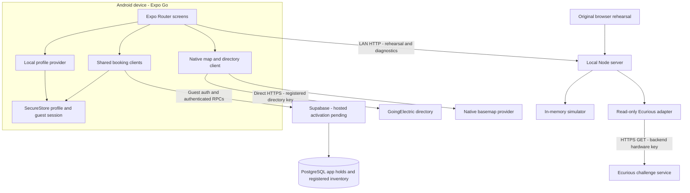
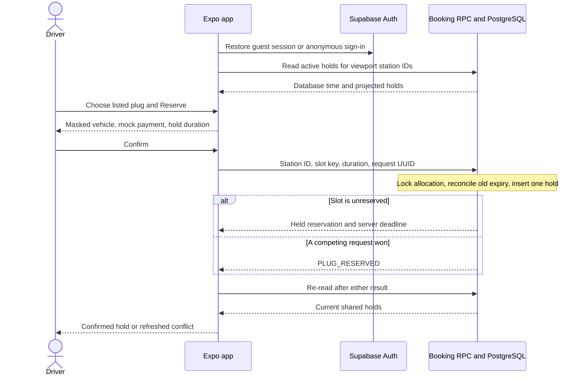
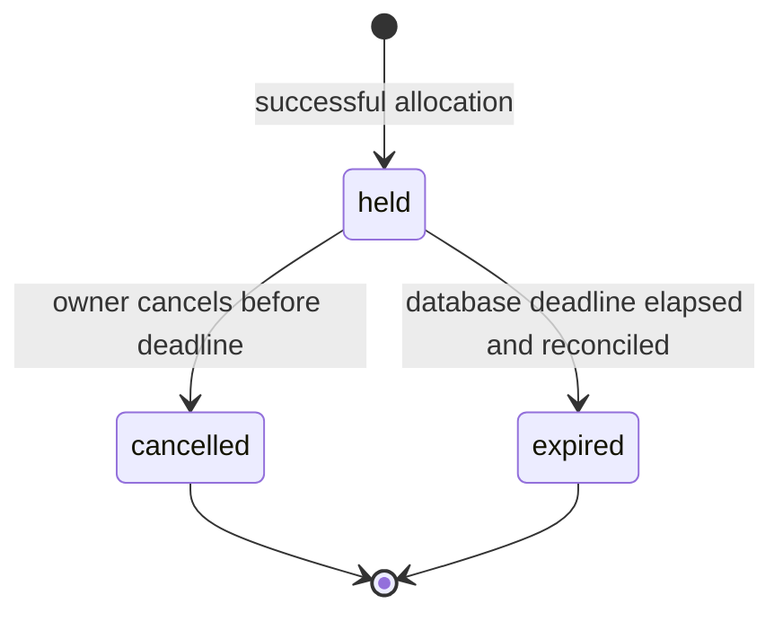

# BayReady system design

This document describes the repository as of 24 October 2026. It connects the product model, mobile screens, data ownership, reservation rules and integration boundaries. Exact database and wire contracts live in [DATABASE.md](DATABASE.md) and [API.md](API.md); setup and recovery steps live in [OPERATIONS.md](OPERATIONS.md).

## Purpose and implementation status

BayReady helps an EV driver find a compatible location, choose a plug, create a short application hold and see its deadline. The hackathon also calls for a real reserve → recognized arrival → charge → release cycle on the designated Ecurious hardware. That physical cycle remains integration work; directory discovery and a shared database hold alone do not fulfil it. See the [source brief](../source/challenge-brief.txt).

| Capability | Current implementation | Practical limit |
| --- | --- | --- |
| Android app | Expo Go, native map, profile, filters and booking UI | Physical phone rendering/gestures still require preview |
| Charger discovery | Direct device GoingElectric API client | Listings have no verified individual bay IDs or live occupancy |
| Driver profile | Native SecureStore; editable local preferences | No verified identity, cloud profile or account recovery |
| Shared app holds | Supabase migrations, guest client, atomic reservation functions | Hosted migrations and anonymous auth still need activation |
| Registered bay inventory | Location → bay → connector, whole-bay exclusivity | Only fictional inventory is seeded; live mode refuses booking |
| Listed plug holds | Separate virtual slots derived from directory groups | Software allocation only; physical correspondence is unknown |
| Lifecycle rehearsal | In-memory Node simulator and original browser UI | Separate state from Supabase; reset/restart loses it |
| Real hardware status | Backend-only authenticated Ecurious GET requests | Reads only; fresh telemetry and sensor meaning need confirmation |
| Payment and charging | Mock payment choice and simulated charge transition | No payment processor, energy delivery or charging-session API |

## Vocabulary and reservation resources

A **location** is a site on the map. A **bay** is a physical space for one vehicle. A **connector** is an individually identified plug associated with a bay. Two plugs can serve the same vehicle space, so a registered bay with CCS and Type 2 still has capacity for one vehicle. Selecting either connector reserves the whole registered bay.

GoingElectric reports aggregate groups such as “4 × CCS, 150 kW.” That is enough to display four **listed app slots**, but does not identify four particular physical bays. BayReady permits a separate software hold on each such virtual slot, initially unreserved when a successful database read finds no active hold. It does not fabricate a physical bay assignment. The UI must identify these as app reservations and keep physical availability unverified.

These are two allocation domains:

| Domain | Resource locked | How inventory is established |
| --- | --- | --- |
| Registered bay | Whole one-vehicle bay, regardless of selected connector | Administrator-approved location/bay/connector rows |
| Directory app slot | One stable virtual slot within a listed connector group | Device derives a key from the current directory listing; database stores only booking references |

A virtual slot is not automatically linked to a registered bay or Ecurious lock. Before moving to physical guarantees, the operator must supply that mapping and reconcile existing virtual holds. The two domains do not currently exclude each other across an unconfigured mapping.

## Architecture and trust boundaries

The Node server does not proxy GoingElectric and does not mediate the Supabase booking RPCs. Supabase holds do not call the Ecurious adapter. The app may therefore browse listings while cloud booking is unavailable, and a hardware read failure does not mutate an application reservation.

| Fact | Authority | What must not be inferred |
| --- | --- | --- |
| Station name, listed plug count/type/power and reported fault | GoingElectric response and retrieval time | Vacancy, operator booking rights, or physical plug identity |
| Active BayReady hold, owner and expiry | PostgreSQL transaction and database clock | Protection from drivers or apps outside BayReady |
| Profile and preferred connector | This device's saved profile | Verified email/phone, authenticated vehicle or payment authorization |
| Physical lock/occupancy observation | Fresh supported Ecurious telemetry | A command acknowledgement or an old report proves current safe state |
| Simulator arrival/charging state | Local rehearsal state machine | Actual camera recognition or electricity delivery |

## Components, tools and source map

The mobile stack is Expo SDK 58, React Native 0.88, React 19.3, Expo Router and TypeScript. Native map rendering uses `react-native-maps`; foreground location uses `expo-location`. `expo-secure-store` stores native preferences and guest credentials, `expo-crypto` supplies request IDs and slot hashing, and `@supabase/supabase-js` supplies auth/RPC transport. The root server uses Node 24+ built-ins with no root runtime dependency installation. Database checks use an isolated PostgreSQL 17 Docker container.

| Source | Responsibility |
| --- | --- |
| [Root layout](../mobile/src/app/_layout.tsx) | Initial profile recovery, protected routes and state providers |
| [Map screen](../mobile/src/app/map.tsx) | Viewport discovery, filters, selection, confirmation and hold display |
| [Profile screen](../mobile/src/app/profile.tsx), [profile provider](../mobile/src/components/profile-provider.tsx) | Onboarding, local edit/save/recovery and skip-to-browse |
| [Driver profile model](../mobile/src/lib/driver-profile.ts) | Versioned normalization and validation |
| [Directory client](../mobile/src/lib/goingelectric-api.ts) | Direct requests, normalization, source links and fixed errors |
| [Registered inventory helpers](../mobile/src/lib/map-inventory.ts) | Compatible plugs, site grouping and separate bay/plug counts |
| [Booking client](../mobile/src/lib/bookings-api.ts) | Guest session, bounded transport, RPC calls and sanitized failures |
| [Registered booking hook](../mobile/src/hooks/use-bookings.ts) | Foreground reads, serialized mutations and freshness |
| [Directory booking hook](../mobile/src/hooks/use-directory-bookings.ts), [slot helpers](../mobile/src/lib/directory-slots.ts) | Scoped shared software holds and stable virtual identities |
| [Simulator client](../mobile/src/lib/reservation-api.ts) | Local API addressing, request validation and mock state |
| [Node server](../server.mjs), [simulator](../lib/simulator.mjs) | Local HTTP and deterministic rehearsal rules |
| [Ecurious adapter](../lib/ecurious-adapter.mjs) | Backend credential boundary and projected read-only hardware data |
| [Migrations](../supabase/migrations/), [SQL tests](../supabase/tests/) | Durable app allocation rules and executable contracts |
| [Launchers](../scripts/) | Environment filtering, LAN startup, inspection and checks |

## Screens and first use

| Route | Role |
| --- | --- |
| `/profile` | First-launch setup or profile editing |
| `/` | Full-screen map after setup or an explicit skip |
| `/map` | Compatible route to the map |
| `/reserve` | Original local lifecycle simulator |
| `/activity` | Simulator timeline and separate hardware diagnostics |

`ProfileProvider` loads before the normal routes. New users see setup and may choose **Explore map first**. A separate setup-seen marker remembers that choice without creating a profile. A valid saved profile also satisfies onboarding. A storage read failure offers retry or browsing; it does not replace unreadable values with defaults. Later retries preserve a mounted form and its draft.

The profile stores `version`, `name`, `email`, `phone`, `licensePlate`, `connectorType`, `paymentMethod` and `updatedAt`. Text is normalized; email is lowercased; phone requires an international `+` country code; plate formatting is normalized. Validation checks format and size, not identity. The profile's plate format is intentionally separate from the older simulator's narrower fictional-plate input.

Supported saved preferences are CCS, Type 2 (`Typ2` in the directory API) and CHAdeMO. They automatically filter directory searches and registered connector choices. Minimum power remains a manual map dropdown value; returning from profile editing retains that screen state. Mock payment is a fixed demo card or wallet choice, without a card-number/CVV form.

A complete saved profile is a mobile UI prerequisite for a new hold. Existing owned holds remain cancellable without one. Profile completeness is not a database authorization rule: RPC ownership comes from the Supabase guest session.

## Discovery and map flow

1. Start at an explicitly configured Berlin viewport; it is not a detected position.
2. Fetch GoingElectric for the viewport, saved connector and minimum power directly from the device. Panning exposes **Search this area** rather than starting an unbounded request stream.
3. Normalize records, reject malformed coordinates and source links, deduplicate station IDs, and retain source attribution, retrieval time and the entry link.
4. Read shared app holds for the displayed station IDs. Only a fresh successful response allows a missing hold to mean unreserved in BayReady.
5. Display compatible choices and app reservation counts. Reported faults and reserved resources have explicit dropdown controls; fictional registered inventory is opt-in.
6. A tap on the location button requests foreground location and centers the map. It does not run background tracking or automatically reserve anything.

Directory results live only in screen memory for about one hour, with periodic and foreground expiry checks. They are not copied into PostgreSQL or a Node cache. Old requests are aborted and sequence-checked so a late response cannot replace a newer search. Large/partial areas ask the user to zoom/search again instead of claiming all chargers have been returned.

The native basemap's required attribution remains visible. GoingElectric attribution is separate. Bounds and padding keep floating controls and detail sheets clear of basemap credits. There is no embedded advertising website.

## Listed plug reservation flow

The product default is initially **unreserved in BayReady**, not a claim that every physical charger is empty. There is no need to insert every public plug into an inventory table before use: the successful hold query is the allocation overlay.

Identical type/power groups at a station are merged before numbering, making the virtual identity independent of directory group ordering. A versioned station/type/power hash prefix plus a one-based ordinal produces the opaque slot key. No station name, address, coordinates, connector catalog or profile values are sent with the hold. A changed type, power or count may leave an earlier key unmatched; owned unmatched holds remain visible for cancellation.

The UI offers 5, 10 or 15 minutes. SQL accepts whole minutes from 1 to 30. A request UUID identifies one operation; reusing it with the same station/slot/duration returns the original reservation and deadline. Reusing it with different parameters fails. A new deliberate user attempt uses a new UUID. Automatic write retries are disabled because a lost response can follow a committed transaction.

The database serializes competing writes to the same slot and additionally enforces one held row with a unique index. Other users learn that the slot is reserved, including its deadline, without receiving the owner's identity or reservation ID. Only the owning authenticated guest can cancel. Other phones refresh on the foreground polling interval; an immediate second write still fails atomically before its UI catches up. The list response also includes the caller's active holds outside the viewport so cancellation remains possible after panning.

An RPC does not currently verify the supplied slot against an operator catalog. This is a cooperative prototype reference scheme; a modified client can invent keys or request many holds. Production needs enrolled resources, abuse controls and an operator-approved mapping rather than treating client-provided keys as trusted capacity.

## Registered bay reservation flow

Registered inventory is normalized as location → bay → connectors. The seeded test location is fictional Berlin inventory: A1 has CCS 150 kW and Type 2 22 kW; A2 has CCS 150 kW; A3 has Type 2 22 kW. Four plugs therefore represent three vehicle spaces. The seed has no GoingElectric ID or hardware link.

The driver chooses location, bay and compatible enabled connector, then confirms a software hold. The reservation records the selected connector while locking the bay row. A composite foreign key ensures that connector belongs to the bay. A partial unique index ensures that choosing the other plug on the same bay cannot admit a second vehicle. Registered rows in Ecurious mode remain unbookable until live orchestration exists.

The hierarchy migration preserves previous IDs, owners, deadlines and idempotency history. Historic holds without a recorded connector get a disabled `UNKNOWN` placeholder; they do not acquire an invented physical plug assignment. See the [database design](DATABASE.md) for exact constraints and migration order.

## Time, expiry and consistency

Both app allocation domains use database time. Read projections treat only nonelapsed held rows as active. A later allocation/cancellation materializes expiry as necessary; a background job is not required to free an elapsed software hold for a new allocation. A row can therefore still say `held` historically while an availability projection correctly excludes it.

The phone anchors its displayed countdown to the returned server time. Reaching zero only changes the display; a subsequent database read decides availability. A booking expiry neither proves physical vacancy nor permits barrier movement. Unlike a charger session, these simple software holds have no arrival, charging or overstay state.

| Policy | Current value | Meaning |
| --- | --- | --- |
| Shared booking foreground poll | 10 seconds | UI synchronization, not real-time delivery |
| Shared booking read-age limit | 25 seconds | Disable writes on stale/unknown app state |
| Supabase transport timeout | 8 seconds per fetch | Auth plus RPC/reconciliation may involve several fetches |
| Directory request timeout | 10 seconds | Bounded discovery attempt |
| Directory memory lifetime | About 1 hour | No persistent directory catalog |
| Local simulator client timeout | 7 seconds | Local API connectivity policy |
| Hardware upstream timeout | 6 seconds | Per upstream read, not a physical confirmation deadline |
| Hardware display freshness | 60 seconds | Conservative app display policy, not a validated safety threshold |

Booking hooks serialize reads and writes. After every mutation outcome, including rejection or timeout, they re-read server state. A failed refresh retains a last snapshot for context but marks it stale and disables actions. Backgrounding stops foreground work/refresh where implemented and invalidates write readiness. Changing the directory query scope also invalidates readiness until that new scope has been read successfully.

## Separate local rehearsal lifecycle

The Node simulator manages one in-memory `demo-bay-1`. It has no shared transaction or record link to either Supabase allocation domain. The simulator's events are newest first and capped at 40; resetting rotates its private plate-fingerprint key. This is useful for repeatable demonstrations of no-shows, blocked spaces and plate uncertainty.

| Trigger | Reservation outcome | Rehearsal behavior |
| --- | --- | --- |
| Reserve empty bay | `awaiting-arrival` | Store masked plate and keyed fingerprint; establish deadline |
| Low-confidence or mismatched arrival | `manual-review` | Entry stays unauthorized |
| Matching observation with confidence at least 0.9 | `authorized` | Lower virtual barrier before setting simulated occupancy |
| Start simulated charge | `charging` | Local state transition; no energy command |
| Authorized vehicle departs | `completed` | Empty simulated sensor permits release |
| Release while empty | Reservation removed | Raise virtual barrier |
| Waiting hold expires while empty | Reservation removed | Reconcile and free the virtual bay |
| Waiting hold expires while externally occupied | `expired-occupied` | Keep obstruction context; wait for clear sensor |

Authorized/charging sessions do not expire as no-shows. An external block is a distinct occupancy source. Release while occupied fails. `expire`, `block`, `clear` and `reset` are scenario controls, not trusted hardware events. The local HTTP server has no user authentication and these controls are unsuitable for a public deployment.

## Real hardware read path and remaining live cycle

Activity requests local `/api/hardware`. The backend sends the Ecurious key in an upstream header and returns a permitted projection: assignment, last-seen time, connectivity, supported telemetry, faults, access-policy counts and recognition presence/time. Raw recognized plates, allowlist values and camera images are omitted. The key is never needed by the phone.

Current adapter writes throw; there is no app-to-barrier command path. An HTTP health result proves service availability only. Old, future-dated, offline or unsupported telemetry yields unknown derived physical state. Recognition presence/time cannot establish that the current driver arrived. The app does not consume the provider's SSE feed; only a connection event was observed during the bounded probe, and documented event names differ from dashboard listeners.

The [Ecurious contract record](ECURIOUS-API.md) documents observed reads and provider command names. Before a live cycle, confirm designated physical mapping, safe motion interlocks, access-list restoration, command/state acknowledgements, actual plate events and accepted charging evidence with mentors. Implement a backend orchestration service with persistent operation state and reconciliation. A successful app hold or command response must never be relabelled as confirmed physical protection.

## Identity, data handling and credentials

The local driver profile and Supabase identity are separate. Supabase anonymous sign-in creates an authenticated guest user whose `auth.uid()` owns holds. A public anon/publishable API key alone is not that identity. Native session persistence lets the installation recover its own holds; losing that session can lose cancellation access. There is no account linking or recovery flow yet.

| Data | Storage/transmission | Current boundary |
| --- | --- | --- |
| Name, email, phone and full plate | Native profile SecureStore | Local only; no profile upload or contact verification |
| Preferred connector and mock payment enum | Same local profile | Connector filters discovery; no processor or real card values |
| Guest access/refresh session | Serialized, generation-indexed SecureStore chunks | Used by Supabase SDK; web fallback is memory only |
| Application holds | PostgreSQL | Resource references, owner, status, times and request UUID |
| Directory station data | Device screen memory and direct provider requests | No directory catalog in Node or database |
| Simulator plate | Request memory, then HMAC fingerprint and mask | No raw plate in simulator snapshots/events/logs |
| Hardware key | Root environment and Node adapter | Excluded from Expo child environment and client code |
| Directory/public Supabase configuration | Expo public environment | Available on the device; never put server credentials here |
| Camera images/raw hardware plates | Not stored or forwarded by app/backend | Hardware-side policies still need organizer agreement |

Profile storage operations are serialized. Unreadable values are preserved; failed saves retain form inputs. Guest session chunks commit a new generation index only after all chunks are written, avoiding mixed refresh-token generations. These measures do not establish GDPR compliance, a retention policy or verified identity.

Tables use RLS with direct client grants revoked. Narrow authenticated `SECURITY DEFINER` RPCs require `auth.uid()`, use a fixed empty search path and project safe fields. Inventory enrollment is administrator-only. Cancellation checks ownership inside the database. Root launchers remove hardware and privileged Supabase settings before starting Expo and reject secret/service-role client configuration. See the [configuration matrix](OPERATIONS.md).

GoingElectric's registered-app, direct-device, attribution, retention and redistribution terms remain relevant. Persisting application booking references is a separate use from caching a catalog; the terms give no explicit exemption for hashes or derived IDs. Provider/mentor confirmation of this cross-device linkage remains an open integration question, not a claim of permission or compliance. Browsing directory data remains available without completing a profile or successfully authenticating to the booking service.

## Design decisions and alternatives

| Decision | Reason and consequence |
| --- | --- |
| Native map with direct device discovery | Fits Expo Go and directory retrieval terms; source data is independent of Node availability |
| Separate directory slots from registered physical bays | Supports the requested shared plug holds without inventing physical topology |
| No preimport of the directory | Own booking rows provide the overlay; names/coordinates/catalog stay at the source/device |
| Allocate a whole registered bay | Multiple connectors do not imply multiple parking spaces |
| Database transactions and uniqueness | Competing phones cannot both win even while their screens show old state |
| Server deadlines and reconciliation | Phone clocks, pauses and lost responses do not create authority |
| Guest auth separated from profile | Ownership works without uploading contact/plate information; recovery and abuse control remain work |
| Local mock payment | Allows confirmation UX without financial handling |
| Read-only hardware until contract is understood | Existing observations are insufficient to prove safe motion, arrival and charging |
| Preserve Node rehearsal separately | Keeps edge cases repeatable while live integration is unfinished; no automatic shared lifecycle |

## Verification, limitations and next stages

Executable evidence is in Node tests, mobile TypeScript checks, SQL contracts and the isolated database concurrency harness. [BUILD-LOG.md](BUILD-LOG.md) records counts, dated API observations, unsuccessful discovery/auth attempts and untested scenarios; [OPERATIONS.md](OPERATIONS.md) gives repeatable commands. Local PostgreSQL auth shims are not a hosted Supabase Auth/PostgREST test. An Android bundle export is not proof of touch behavior or physical hardware integration.

The remaining deployment/integration order is:

1. Apply migrations in order and enable anonymous sign-in in the hosted Supabase project. Verify RPC grants and two-phone conflicts, cancellation and expiry.
2. Preview profile, map, permission prompts, dropdowns and sheets on Android Expo Go. Confirm source attribution remains visible at different screen sizes.
3. Validate virtual-slot use with the data provider/mentors; get operator-assigned physical bay and connector identifiers for guaranteed reservations.
4. Implement one supervised Ecurious full cycle with trusted events, safe command sequencing and durable reconciliation. Record actual charging evidence agreed with organizers.
5. Extend with authenticated accounts/recovery, quotas and abuse protection, retention/deletion, operator administration, monitoring and measured capacity/load tests.

Scaling is a proposal, not an implemented claim: use operator-owned inventory and mappings, paginated/scoped availability, persistent hardware operations, background reconciliation and documented integration adapters. Directory-slot client claims, global registered-inventory reads, polling volume and unbounded booking history need explicit production policies. Interoperability may later use an agreed external contract; no OCPI/OCPP compliance, roaming interoperability or public-infrastructure control is claimed here.

The proposed mission answers are short holds/no-show expiry and occupied-bay recovery. Financial penalties, directions/ETA, reminders, payment settlement, operator escalation, live charging, plate-driven access and production hosting are future features. Hypothetical fees and utilization inputs remain labelled assumptions in the [business model](BUSINESS-MODEL.md).
