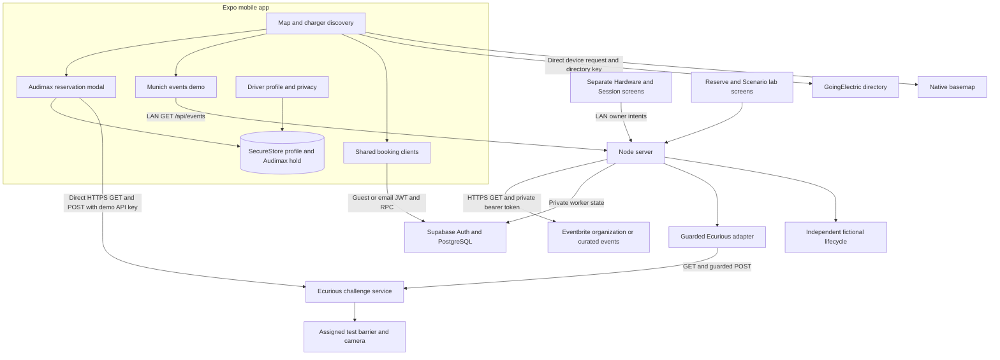

# BayReady system design

This describes the implementation pulled in commit `05b7986` on 24 October 2026, the subsequent Eventbrite planner integration, and the retained booking services and rehearsal tools. The presentation path is the **Audimax hardware card on the Map**, which sends commands directly to Ecurious. The separate **Hardware test** screen uses the older Node/Supabase workflow; the two paths have different ownership, timing and camera policies.

Use [README.md](../README.md) for startup and the simple demo, [API.md](API.md) for wire contracts, [DATABASE.md](DATABASE.md) for tables/transactions, and [BUILD-LOG.md](BUILD-LOG.md) for dated observations. Code availability, HTTP acceptance, device reports and an observed complete customer cycle are different kinds of evidence. The user reports that the pulled app path works; this document does not manufacture additional camera, charging or reliability evidence.

## Product and current capabilities

BayReady connects charger discovery to a reservation and vehicle access experience. It addresses the gap between finding a charger on a map and having access to its parking bay on arrival. The challenge requires app ↔ Ecurious server ↔ designated hardware integration; public directory software holds alone do not meet that requirement. The [source brief](../source/challenge-brief.txt) defines the deliverables and judging criteria.

| Capability | Implemented behavior | Scope of the claim |
| --- | --- | --- |
| Mobile app | Expo Go, native map, profile, filters and booking sheets | Android is the primary target |
| Discovery | GoingElectric requests directly from the device; listed connectors, power and reported faults | Directory information, not real-time vacancy |
| Driver setup | Local name/contact/plate preferences, connector selection and mock payment | Formatting checks do not verify identity or payment |
| Audimax hardware demo | Direct lock/whitelist/unlock requests from the Map; countdown, extensions and occupancy display | Selected `lock-0002` is barrier-only test hardware, with no charger |
| Events | Backend Eventbrite feed, explicit seven-event demo option and five nearby suggestions ordered by distance | Real events need an organization or curated IDs; nearby charging counts remain separate/unverified |
| Shared public bookings | Supabase guest/email identity, virtual directory-slot holds and owner cancellation | Shared software allocation, without public hardware control |
| Registered inventory | Location → one-vehicle bay → connector; whole-bay exclusion | Physical topology requires operator enrollment; the ordinary seed is fictional |
| Durable hardware workflow | Node worker, private operation ledger, scheduled windows, camera matching and cleanup guards | Retained separate implementation; not the direct Audimax Map flow |
| Session/rehearsal | Older hardware session view, independent simulated charging and multi-car lab | No measured energy or real payment; the pulled Audimax hold is not linked to the older session route |
| Privacy controls | Local profile export/deletion, owner cloud export and pending-review erasure intake | Provider data and operating obligations are separate; GDPR compliance is not established |

## Architecture and allocation domains

There are four distinct reservation domains. A booking in one does not create a booking in the others.

| Domain | Resource and authority | Persistence and physical effect |
| --- | --- | --- |
| Direct Audimax demo | A selected API lock; local phone hold plus actual provider state | One SecureStore record on that phone; direct real barrier/whitelist commands |
| Directory app slot | One virtual slot in a listed station/type/power group; Supabase transaction | Shared SQL hold; no control of the listed public charger or barrier |
| Registered bay | Administrator-defined one-vehicle bay and one selected connector | SQL whole-bay allocation; Ecurious bays use the separate durable workflow |
| Local rehearsal | One fictional Node bay, or independent multi-car lab world | Simulator memory; no physical commands or payment |

A **location** is a site. A **bay** is a space for one vehicle. A **connector** is a particular plug attached to that bay. Selecting either of two connectors serving the same bay still consumes one vehicle space.

GoingElectric counts such as “4 × CCS” provide listed plug choices, not four verified physical bay identities. Directory slots use a station/type/power-derived opaque reference plus ordinal. They are not automatically mapped to Ecurious locks. The explicitly enrolled `lock-0002` uses a `BARRIER_TEST` interface at **0 kW**, without a GoingElectric station mapping or actual charger.

## Screens and driver experience

| Entry point | Behavior |
| --- | --- |
| First launch / `/profile` | Save local preferences or choose **Explore map first**; optional contacts and plate |
| `/` and `/map` | Full-screen native map, public listings, Audimax marker and event entry point |
| **Filters** | Minimum power, saved connector link, reported faults, reserved visibility, public chargers and optional fictional inventory |
| Map location control | Request foreground location on demand and center the viewport |
| Map **Bookings** | Shared current/upcoming directory holds and their deadlines |
| Purple **Audimax TUM** marker | Live hardware cards, lock selection and **Reserve now or book ahead** |
| **Events** | Load Eventbrite events or choose labelled demo events, inspect nearby suggestions, open the source event or select a map/hardware destination |
| `/sign-in` | Guest/email identity and guest conversion; independent of the local driver profile |
| `/hardware` | Separate authenticated Node/Supabase hardware workflow, diagnostics and owner actions |
| `/session` | Separate older hardware booking or simulator session duration/details |
| `/reserve`, `/activity`, `/simulation` | Original simulator, timeline/read diagnostics, and fictional multi-car lab |
| `/privacy` | Profile export/deletion, cloud export and pending Ecurious erasure request |

The current map starts around **TUM Munich** (`48.1488, 11.568`); it is not a detected user position. Panning exposes **Search this area**. Connector preference automatically filters directory results; minimum power stays a manual dropdown choice. Directory requests are aborted/sequence-checked when superseded, and station results remain in screen memory for about one hour. Attribution, retrieval time and source links remain separate from the native basemap attribution.

Profile data is versioned and normalized, with name/email/phone/plate optional. Email/phone format validation is not verification. Payment is an enum such as demo card or wallet; no card number or CVV is collected. The direct Audimax demo uses the saved plate, or its built-in demonstration plate if none is entered. Set the intended fictional test plate before presenting so the camera demonstration and the displayed booking agree.

## Direct Audimax hardware demo

The pulled implementation is in [map.tsx](../mobile/src/app/map.tsx), [audimax-booking-modal.tsx](../mobile/src/components/audimax-booking-modal.tsx) and [audimax-lock-api.ts](../mobile/src/lib/audimax-lock-api.ts). This path does not call the Node booking routes or Supabase allocation functions.

The phone lists assigned locks with `GET /api/v1/locks`, accepting either `locks` or `assignedLocks` in the response. `lock-0002` is preferred and labelled **ACTIVE DEMO**. Other assigned devices may be returned by the service; the selected challenge demonstration is `lock-0002`.

| Action | Direct API sequence | Local result |
| --- | --- | --- |
| Reserve now | `POST /api/v1/locks/:id/lock`, then `POST /api/v1/locks/:id/whitelist` with `{plates:[plate]}` | Save active hold after both HTTP responses succeed |
| Schedule ahead | Save arrival, raise time and expiry locally; run the same reserve sequence when raise time is reached | `scheduled` becomes `active` |
| Extend | No additional hardware request | Add 30 seconds to local expiry; display €1 mock fee |
| Vehicle detected | Periodic `GET /api/v1/locks` returns `carPresence: occupied` | `active` becomes `occupied`; stop unused-hold expiry |
| Leave / no-show release | `POST .../whitelist` with `{plates:[]}`, then `POST .../unlock` | Clear local hold after release resolves |
| Cancel a future local booking | No hardware request while it remains only scheduled | Clear local hold |

The two movement POSTs contain no explicit JSON movement options in this direct client. The API key is supplied in the URL query. Success is determined by HTTP status; the client does not parse a movement acknowledgement body or wait for a newer matching sensor observation before displaying success. Consequently, the current “Barrier Raised” success copy means the command sequence succeeded at HTTP level. Actual barrier position comes from watching the rig and its separate reported status.

### Timing and state

| Policy | Audimax presentation demo | Shared/durable product workflow |
| --- | --- | --- |
| Reserve now | Free 30-second arrival hold | Free ten minutes |
| Extend | +30 seconds / €1 mock | +ten minutes / €1 mock |
| Schedule fee | €1 displayed; no collection | €1 mock, recorded in applicable server booking |
| Protection lead-in | Arrival minus 30 seconds | Arrival minus ten minutes |
| Initial unused deadline | Arrival plus 30 seconds | Arrival plus ten minutes |
| Clock and scheduler | Device clock and React timer | Database time and backend reconciliation |

`AudimaxActiveHold` stores `lockId`, `lockName`, raw `plate`, `reservedAt`, `bookingMode`, optional `startsAt`, `raiseAt`, `expiresAt` and `status`. Native persistence uses SecureStore key `bayready.audimax.active-hold.v1`; the web fallback is memory only. One record exists per app installation, rather than a shared booking calendar.

The local states are `scheduled`, `active` and `occupied`; release removes the record. The timer ticks approximately once per second. While active, status is normally polled about every three seconds; while occupied, about every ten seconds. Reading provider status does not make an old provider timestamp new.

Keep the Map mounted, foregrounded and connected during this demonstration. A phone timer is not a reliable background scheduler. Relaunch restores the stored hold, but cannot prove that a scheduled movement or cleanup ran while the app was suspended. Once occupied, this path waits for **Leave Bay**; it does not automatically complete the booking after a later vacant report.

### Camera and plate access

This demo installs a plate on the device whitelist and delegates automatic access to the Ecurious camera/device system. It does not call a custom YOLO model, poll `plate/latest` for entry authorization, or privately compare a scan in Node. Occupancy detection is a separate sensor fact; an occupied bay alone does not establish that the whitelisted vehicle entered.

The whitelist is persistent device policy, without an application booking TTL. The phone clears it during its release sequence. Whitelist programming is not an injected OCR event. Actual recognition must be demonstrated with the provided camera/test infrastructure. The older backend workflow instead reads native latest OCR, privately matches it and requires device automatic access disabled. These are alternative entry controllers and must not be presented as one combined flow or allowed to compete over the same test lock.

### Failure boundaries and concurrency

The direct path trades durable orchestration for a short demonstration flow. Its limits are visible in the implementation:

- Raising and whitelist installation are two requests, not an atomic operation. If whitelist installation fails after raising, no successful local hold is saved and there is no automatic compensating release.
- Release attempts whitelist clearing first. An HTTP error from clearing is warned about and unlocking continues; success of unlocking therefore does not prove the plate policy was cleared. A network exception can stop the sequence earlier.
- There is no explicit request timeout, idempotency token, committed dispatch permit or durable command ledger in this client. Scheduled attempts can run again while the local hold remains scheduled after failure; overlapping asynchronous work is not fenced by a database.
- Local `busy` state reduces repeat taps but does not provide multi-device ownership. Another phone can operate the same lock or overwrite its whitelist. The direct local hold does not exclude competing Supabase or direct-device bookings.
- SecureStore helpers swallow storage errors and stored JSON is cast rather than schema-validated. Displayed in-memory success is not proof that a hold can be restored after restart.
- Raw upstream error text can be placed in UI errors or console warnings. The direct API path does not inherit the older backend adapter's projected responses, fixed error vocabulary or plate-log protections.

These are recorded limitations and implementation priorities, not verified production guarantees. They explain why the retained durable allocation/worker design remains useful beyond the single-team demonstration.

## Event discovery and nearby suggestions

The Event planner now reads **`GET /api/events`** from Node. [eventbrite-events.mjs](../lib/eventbrite-events.mjs) sends backend-only bearer-authenticated GET requests to Eventbrite. Public city-wide event search is unavailable; the feed supports `EVENTBRITE_ORGANIZATION_ID` or up to ten comma-separated `EVENTBRITE_EVENT_IDS`. With neither selector, it discovers the token owner's organizations and automatically uses one only when exactly one is returned. Multiple organizations require explicit selection. The private token is `EVENTBRITE_PRIVATE_TOKEN`, with `EVENTBRITE_TOKEN` accepted as an alias.

Organization requests use `time_filter=current_future` and `expand=venue`; curated requests retrieve each configured event with its venue expanded. Normalization includes only public listings (`listed:true`), `live`/`started` status, valid UTC start/end times with the end still future, an in-person venue with real coordinates within 50 km of TUM Munich, and an HTTPS Eventbrite source URL. Missing coordinates are rejected rather than replaced with a marker at zero. Attendance is **Not provided**; venue capacity is not converted into an expected crowd. Returned events are deduplicated, ordered by start and bounded to fifty.

The response is `{configured, source:'eventbrite', scope, events, reason, fetchedAt}`. `scope` is `organization`, `curated` or `not_configured`; each event supplies `{id,title,subtitle,category,emoji,venue,address,latitude,longitude,date,expectedAttendance,url,startsAt,source:'eventbrite'}`. Human-readable dates use Berlin time; `startsAt` and `fetchedAt` are UTC instants. No token, organization membership details or raw provider error body is returned to the phone.

Provider reads have a six-second per-request timeout, a 1 MiB body limit and redirect rejection. Concurrent feed reads share one in-flight load; Node caches its normalized result for sixty seconds. Organization retrieval is bounded to two pages. A configuration error, provider failure or empty eligible selection produces an empty event array and a fixed explanatory `reason`, without silently inserting samples. The supplied token was successfully verified with read-only requests on 24 October; its initial organization feed contained **zero eligible Munich events**. That is a dated observation, not a promise that the source remains empty.

The mobile [events client](../mobile/src/lib/events-api.ts) validates the feed, bounds it to 500 KB/100 events and uses a twenty-second request timeout. [use-events.ts](../mobile/src/hooks/use-events.ts) loads when the modal opens, aborts superseded/closed requests and supports refresh. The UI labels **Eventbrite events**, source update time and **View on Eventbrite** separately from the charger suggestions. A configured empty feed stays empty until **Use demo events** is chosen. Missing configuration or a mobile request failure displays an explicit **Demo events** state; its seven fictional Munich samples never acquire an Eventbrite badge.

[munich-events.ts](../mobile/src/lib/munich-events.ts) retains those seven **fictional event presets** spanning tech, sport, culture and concerts. Their dates, attendance figures and static nearby-charger examples are demonstration content, not verified operator inventory. Live Eventbrite events and the sample selection use the same nearby-charging ranker.

Candidates combine the Audimax hardware card, currently fetched GoingElectric stations and static Munich examples. Haversine distance orders the nearest five; it is straight-line distance, not walking/driving distance, travel time or GPS ETA. Selecting a directory candidate opens the fetched station when present. Selecting a static example centers the map but does not create a booking or a real routing instruction. Selecting Audimax opens the existing direct hardware booking modal, whose timer and request behavior are unchanged by Eventbrite.

Ranking code still substitutes one nominal free spot for some unknown directory availability and always supplies a demonstration Audimax candidate. Static examples contain invented counts. The updated UI calls them **nearby charging options**, states that app/demo counts do not prove physical vacancy, and labels Audimax **Barrier only / No charger attached**. The candidate model retains illustrative CCS/150 kW metadata internally; the event card now suppresses it for hardware and it is not a real charger fact. A production version needs genuine operator availability, explicit source labels and route/ETA integration; a real event listing does not establish reservable charging nearby.

## Shared Supabase allocations and durable hardware

The retained server-backed implementation is separate from the direct Map demo. [DATABASE.md](DATABASE.md) documents the exact tables, role grants, migration history and SQL contracts; [SCHEDULED-SESSIONS.md](SCHEDULED-SESSIONS.md) documents quotes, windows, mock refunds and session fields.

Directory virtual holds use authenticated guest/email RPCs, a database clock, request UUIDs, allocation locks and uniqueness/interval rules. After a successful scoped read, a slot with no current hold is unreserved **in BayReady**. A stale or failed read means unknown. Owner cancellation is checked within SQL; other users receive resource/deadline facts without owner details. The client refreshes after mutations, including conflicts or uncertain responses. A changed directory group can orphan an older key; owned holds remain available for cancellation. Provider permission for cross-device derived booking references remains unresolved; hashing alone does not establish it.

Registered inventory uses `charging_locations` → `bookable_bays` → `bay_connectors`. Selecting a connector records that choice while excluding the entire bay. Composite relationships prevent selecting another bay's connector. The fictional seed has multiple connector types sharing one vehicle space; it is opt-in on the map. Generic software inventory RPCs exclude real Ecurious bays.

The older physical workflow stores enrollment, controls, observations, scheduled slots and operation history privately. Owner JWTs request intent; backend-only credentials claim work. A replaceable predispatch lease leads to a committed one-use dispatch permit, a single movement attempt, a durable acknowledgement and a strictly newer target observation. Unknown delivery stays quarantined because a delayed dispatcher could still send. Cancellation/no-show expiry retains the bay until confirmed cleanup. Conflicting same-time facts require a newer observation. These guarantees belong to this durable path, not the direct client above.

Its phases include `idle`, `protect_pending`, `protecting`, `protected`, `entry_pending`, `entering`, `entry_open`, `release_pending`, `releasing`, `blocked` and `uncertain`. Current assignment, enrollment, allowlist, interlocks and observation preflight gate movement. Native OCR is privately matched using a stable backend HMAC key; accepted entry ends the unused-arrival timer, while occupied arrival and later vacant departure remain distinct observations. No-ACK recovery requires stopping dispatchers before privileged reconciliation. Details are in [HARDWARE-SETUP.md](HARDWARE-SETUP.md), [BAY-LIFECYCLE.md](BAY-LIFECYCLE.md) and [ECURIOUS-API.md](ECURIOUS-API.md).

For a scheduled durable booking, protection is deferred until T−10; a compatible alternative at the same enrolled location can replace an occupied target. A full location can record a mock refund and suggest verified alternatives. These behaviors must not be claimed for the direct Audimax hold, which has no shared calendar, automatic same-location reassignment or server refund ledger.

## Sessions, simulation and charging evidence

The existing `/session` screen reads the older authenticated hardware slots/workflows or the simulator. It can show time since confirmed arrival, masked vehicle, connector, booking status, deadlines, extension information and available hardware facts. It does not read the direct Audimax SecureStore hold. A hardware presence duration is a parking/session duration, not electrical charging time.

The Node simulator is independent of Supabase and real locks. It models reserve → fictional plate check → simulated charging → departure → release, including blocked bays, no-shows and recognition uncertainty. Its events are bounded in memory and reset/restart loses state. The separate multi-car lab uses three fictional drivers, seven guided cases, an accelerated clock and explicit command/sensor steps; it does not establish live multi-device hardware behavior. [MULTI-CAR-SIMULATION.md](MULTI-CAR-SIMULATION.md) distinguishes that rehearsal from actual isolated PostgreSQL concurrency tests.

No payment processor, live charging power, delivered energy, charge-start integration or verified electrical session is provided for the barrier-only test rig. Any “Parked & Charging” wording in its prototype UI is illustrative. Agree with organizers how to demonstrate the charging stage when using barrier-only hardware, and label any simulated stage explicitly.

## Identity, credentials and data handling

The local profile and Supabase identity are different. Guest Auth creates an owner UID; optional email/password sign-in can convert that guest while retaining ownership. Signing into a different account changes owner scope. Profile contacts are not automatically an Auth account, and format validation is not verified identity. A lost guest session has no implemented recovery path.

| Data or credential | Current handling | Important distinction |
| --- | --- | --- |
| Name, optional contacts, connector and mock payment | Local profile SecureStore | No automatic profile sync |
| Direct Audimax booking plate | Raw plate in local active hold and HTTPS whitelist request | Sent directly to Ecurious; not HMAC-only in this flow |
| Direct Audimax hardware credential | `EXPO_PUBLIC_AUDIMAX_API_KEY` in phone bundle and API URL query | Public client configuration is extractable; this is not a backend-only secret |
| Launcher credential fallback | `AUDIMAX_API_KEY` or root `ECURIOUS_API_KEY` can populate the public Audimax variable | Removing the original environment variable does not undo this copied exposure |
| GoingElectric key | Public Expo variable, direct device requests | Available to the device; provider app/usage terms still apply |
| Supabase public key and guest/email session | Public app configuration plus native session storage | Public key is not ownership; JWT identity and SQL checks authorize bookings |
| Supabase private key, access token and plate HMAC key | Backend/setup environment only | Not needed by the direct Audimax phone client |
| Eventbrite private token and selectors | Backend Eventbrite adapter; all `EVENTBRITE_*` variables removed from Expo child environment | Bearer header only; no token in event URLs or feed responses |
| Public Eventbrite event/venue facts | Bounded normalized Node cache and mobile feed state | Organization/curated selection, not global discovery; no attendee lists or ticket-purchase API |
| Older hardware booking/scan plate | Transient Node matching; SQL keyed fingerprint/masked suffix | Different processing path from direct whitelist programming |
| Directory catalog | Device memory, source attribution/time/link | No server catalog import; shared booking references are separate |
| Cloud bookings and private operation history | Supabase SQL, scoped RPCs/private worker access | Retention and erasure fulfillment still require operator policy |

The direct lock response type can include a whitelist and latest recognized plate metadata. The app does not need a separate AI model or camera-image archive to demonstrate access. The backend diagnostics projection is more restrictive than the direct fetch; its privacy guarantees must not be attributed to raw direct responses.

Existing privacy export/deletion controls cover the local **profile** and specified owner cloud records. They do not export/delete the separate Audimax active-hold record or revoke its provider whitelist. Deleting a profile is therefore not a complete removal of direct-demo plate data. Provider camera/whitelist retention, notices, controller details, lawful basis, access/erasure fulfillment and credential rotation still need an operating policy. Ecurious is the intended operator; no GDPR compliance claim follows from SecureStore, hashing or an erasure-request button. See [PRIVACY.md](PRIVACY.md).

## Source map, decisions and next steps

| Source | Responsibility |
| --- | --- |
| `mobile/src/app/map.tsx` | Native discovery, shared booking UI and local Audimax scheduling/occupancy state |
| `mobile/src/components/audimax-booking-modal.tsx` | Direct hardware Now/Schedule/Extend/Leave UI |
| `mobile/src/lib/audimax-lock-api.ts` | Direct provider requests and local active-hold persistence |
| `mobile/src/lib/munich-events.ts`, `mobile/src/components/munich-events-modal.tsx` | Fictional event candidates, distance ranking and selection |
| `mobile/src/lib/events-api.ts`, `mobile/src/hooks/use-events.ts` | Validated Eventbrite feed reads, modal refresh and source state |
| `lib/eventbrite-events.mjs`, `GET /api/events` in `server.mjs` | Private-token organization/curated event retrieval and bounded public projection |
| `mobile/src/lib/goingelectric-api.ts`, `directory-slots.ts` | Direct directory normalization and virtual slot identities |
| `mobile/src/lib/bookings-api.ts`, booking hooks | Authenticated shared allocation reads/writes |
| `mobile/src/app/hardware.tsx`, `session.tsx` | Separate durable hardware owner UI and session projection |
| `server.mjs`, `lib/hardware-workflow.mjs`, `lib/hardware-store.mjs` | Authenticated intents, durable commands and reconciliation |
| `lib/ecurious-adapter.mjs` | Projected provider reads and guarded single-attempt movement methods |
| `supabase/migrations/`, `supabase/tests/` | Allocation, permission, timing and concurrency contracts |
| `lib/simulator.mjs`, multi-car simulation code | Repeatable fictional lifecycle and edge cases |
| `scripts/mobile-environment.mjs`, launch scripts | Expo configuration, credential forwarding and LAN startup |

The useful design choices are direct device discovery, explicit separation of virtual slots from physical bays, whole-bay exclusion for multiple connectors, mock rather than real payments, and a simple accelerated hardware demonstration. The largest current integration gap is having two independent command controllers for one device and a direct demo whose ownership/timing does not survive other clients or a suspended app.

After the demo, consolidate the working camera/whitelist behavior into one durable reservation owner; use server-side scheduling and narrow authenticated intents, explicit command outcomes and cleanup records. Add operator-owned bay mappings, shared contention handling, recovery for partial requests, source-labelled event availability, arrival reminders/ETA, payment/refund reconciliation, operating privacy controls and charger telemetry only when supplied. Keep the fast single-team rehearsal distinct until those contracts are implemented and tested.

The [challenge workflow](CHALLENGE-WORKFLOW.md) covers all twenty guiding questions with concrete suggestions. Read its older backend-controlled camera sections with the controller distinction above: the pulled Map demo now demonstrates the whitelist alternative. No-shows have a visible 30-second demo; blocked-bay fallback belongs to the separate durable/lab paths; the Eventbrite planner connects actual source events to a proposed host use case while retaining labelled samples. Ticket/booking entitlement, sponsored charging and event-wide capacity guarantees are not implemented. Cross-app reservation APIs, OCPI/OCPP mappings and roaming/settlement are future integrations, not established compliance.

The [business model](BUSINESS-MODEL.md) separates the current mock tariff from proposed operator subscriptions, sponsored bookings and paid reservation experiments. Measure recovered usable bay time and actual incremental charging contribution **after subtracting empty reservation time and operating costs**. Pricing, utilization uplift and ROI remain hypotheses; the business must not depend on penalty income or invented live availability.
